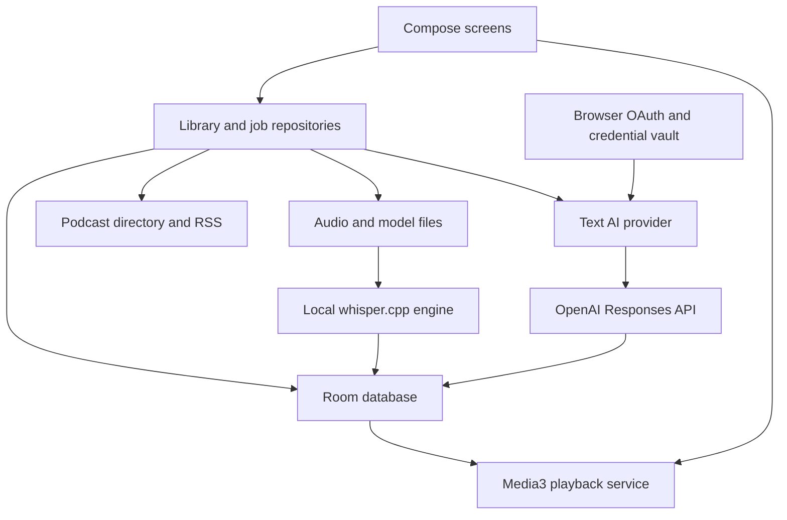

# DistillPod Android implementation plan

Date: November 1, 2026
Status: Implementation started on `feat/native-android`; feasibility gates remain open
Baseline: `master`, commit `758cbc07f6d35b39d39a4fc66c57553e00297b79`

Build a native Android podcast app that stores its library on the phone, transcribes audio locally, and uses the owner's existing eligible ChatGPT subscription for text AI features. The primary design requires no DistillPod server. OpenAI inference still happens in the cloud; local storage and local transcription do not make those requests offline.

The first deliverable is a working Android authentication and transcription experiment. A successful experiment unlocks the full application build. Subscription access, supported models, Android authentication behavior, and transcription performance must be demonstrated on the target account and phone before they become product promises.

See [implementation status](android/implementation-status.md) for delivered code, test evidence and remaining gates. The November 2 personal alpha has [physical summary/chat/ad-review and database-upgrade evidence](android/evidence/s22-understanding-tests.txt), [account renewal and backup restore evidence](android/evidence/s22-renewal-restore-tests.txt), and [local build/test evidence](android/evidence/personal-alpha-build.json). The owner chose a fresh Android library, so legacy server/browser migration is deferred for this delivery. Task checkboxes represent full acceptance criteria, not partial code coverage.

Existing online transcript lookup before Whisper is documented separately in the [lookup design and validation](android/online-transcripts.md). It reads existing public transcripts and does not create cloud transcription jobs.

The optional cloud extension is planned separately in the [Firebase sync and telemetry implementation plan](android/firebase-sync-telemetry-plan.md), including complete scope, TDD tasks, account isolation, recovery and release gates. That plan does not change the delivered capabilities recorded here.

## 1. Outcomes and working assumptions

### Required outcomes

- Native Android screens and background podcast playback.
- Search, subscriptions, feed refresh, streaming, downloads, queue, and listening progress.
- Timestamped transcripts and a button that captures the preceding 60 seconds.
- ChatGPT-powered quotes and insights using the user's authorized plan allowance.
- Episode summaries, chapters, grounded chat, ad detection, recommendations, and research in subsequent milestones.
- Preserve existing DistillPod data through an explicit migration path.
- Useful playback and saved content when offline, signed out, or out of AI allowance.
- An installable personal-use build, with a separate task set for broader distribution.

### Assumptions to confirm

| Decision | Planning default | When to resolve |
| --- | --- | --- |
| ChatGPT tier and entitlement | Eligible Plus or Pro account; actual tier unknown | Before the authentication experiment |
| Phone | Samsung Galaxy S22 Ultra SM-S908E, Android 16/API 36, ARM64; [device matrix and initial validation](android/s22-validation.md) recorded | Before transcription benchmarking |
| Languages | English and Brazilian Portuguese benchmark samples | Before selecting the transcription model |
| First distribution | Signed APK for personal use | Before release signing |
| UI | Kotlin and Jetpack Compose | After feasibility experiments |
| Android support | Tentatively Android 10+; ARM64 production ABI | Freeze after toolchain and device checks |
| Data ownership | One local library per installation; ChatGPT account is a provider connection | Before database schema freeze |
| Cloud text processing | User enables plan usage and sees which content is sent | Before live inference |
| Existing deployment | Keep usable during migration | Until a successful restore and phone trial |

These defaults let implementation proceed without assuming hardware or account access that has not been established. A phone or plan constraint may change the technical design, but does not require restarting the planning work.

### Release boundaries

| Release | Included | Explicitly later |
| --- | --- | --- |
| Feasibility build | Sign-in, one streamed text result, local timed transcription, background-processing experiment | Finished UI and library migration |
| Personal alpha | Library, downloads, player, queue, transcripts, distillations, basic backup | Full AI feature parity |
| Personal beta | Chapters, chat, ad skipping, migration, reliability and accessibility | Research and recommendation automation |
| Feature-complete personal release | Research, recommendations, configurable refresh, export, documentation | Optional server synchronization and public store release |

Core playback must not require ChatGPT login. No release silently switches to a separately billed provider. Full offline language-model inference, multi-device synchronization, destructive ad-free audio export, Android Auto, wearables, and Telegram integration are optional follow-up work.

## 2. Evidence and feasibility limits

OpenAI documents an open-source/local-app flow that lets eligible Plus and Pro users authorize plan-backed requests. Sign-in and plan usage are separate permissions. Paid or remotely hosted distribution has additional eligibility considerations. See the [quickstart](https://developers.openai.com/siwc/quickstart) and [integration overview](https://developers.openai.com/siwc/token-sharing-open-source).

The documented flow uses browser authorization, PKCE, an installation identifier, and dynamic client registration. It requires an HTTP loopback callback on `127.0.0.1`; this needs a real Android browser/lifecycle experiment. The official DevKit supplies Node/React components and a macOS example, rather than a verified Kotlin implementation. Its code has a noncommercial license; implementing the published protocol and copying DevKit code are separate decisions. See [registration](https://developers.openai.com/siwc/token-sharing-open-source/sign-in) and the [DevKit](https://github.com/openai/sign-in-with-chatgpt-devkit).

Plan-backed requests use the public Responses endpoint with OAuth credentials. Model discovery and completed inference must both succeed. The preview requires streaming with storage disabled, excludes audio transcription, and restricts tools and request fields. Web search is conditional on model and account policy. See [inference](https://developers.openai.com/siwc/token-sharing-open-source/models-and-inference) and [preview limitations](https://developers.openai.com/siwc/token-sharing-open-source/preview-limitations).

Usage consumes the existing Codex/ChatGPT work allowance and can have per-app caps. The connection does not import ChatGPT memory or conversations. See [plan usage](https://learn.chatgpt.com/docs/sign-in-with-chatgpt). Do not promise unlimited processing or automatic access to the ChatGPT product's Deep Research workflow.

Local Android transcription has an upstream [whisper.cpp example](https://github.com/ggml-org/whisper.cpp/blob/master/examples/whisper.android/README.md). Tiny and base are candidate starting models, not measured quality/performance claims for this app. Published [podcast transcripts](https://podcasting2.org/docs/podcast-namespace/tags/transcript) can avoid transcription when a suitable timed transcript matches the audio.

### Reference implementations

| Reference | What to learn | Constraint |
| --- | --- | --- |
| [Paste Perfect](https://github.com/openai/sign-in-with-chatgpt-devkit) | Official authorization, model discovery, streamed inference, account UI | Desktop reference; review code license before reuse |
| [gray-chatgpt](https://github.com/DanielOu1208/gray-chatgpt) | Independent implementation of the published direct subscription flow | Not Android; inspect and test before borrowing design |
| [Buddy Android](https://github.com/ghorbelhamdi/buddy-android) | Codex running in an Android-hosted Linux environment | Community project; larger runtime than direct OAuth |
| [chatgpt-oauth](https://github.com/vishhvak/chatgpt-oauth) | Kotlin API and credential-storage ideas | Uses undocumented endpoints; author reports unverified Android runtime paths |
| [Android offline recorder](https://github.com/yamanobora/Android-Offline-AI-Recorder-Whisper-LLM-On-Device-) | Kotlin/JNI speech recognition and local summarization | Experimental; not a tested podcast replacement |

No third-party package is selected solely because its README lists Android support. The preferred path is the published direct protocol. Codex in Termux or embedded Linux is a conditional fallback, not a hidden dependency of the primary app.

## 3. Current code and migration map

The current app is a React/TypeScript frontend and FastAPI backend. Most AI features call Claude CLI; transcription uses faster-whisper. SQLite stores server data, while browser storage holds queue and progress. This is a new Android implementation of the workflows, not a wrapper around the existing web UI.

| Existing source | Current responsibility | Android destination |
| --- | --- | --- |
| `frontend/src/App.tsx`, `pages/`, `components/` | Navigation, library, player and AI screens | Compose navigation and feature screens |
| `frontend/src/context/AudioContext.tsx` | Persistent audio, media controls, progress | Media3 playback service and playback repository |
| `frontend/src/stores/queueStore.ts` | Persistent queue and ordering | Transactional Room queue |
| `backend/services/podcast_index.py`, `rss.py` | Search and RSS parsing | Podcast directory and feed repositories |
| `backend/services/downloader.py` | Audio caching | Resumable managed downloads and media manifest |
| `backend/services/transcriber.py` | Whisper and timestamp persistence | JNI transcription engine and checkpointed jobs |
| `backend/services/snip_engine.py`, `routers/gists.py` | Excerpt extraction and distillation | Local excerpt service and AI provider |
| `backend/services/chapterizer.py`, `routers/chat.py` | Chapters, summary, transcript Q&A | Analysis and conversation repositories |
| `backend/services/ad_detector.py` | Ad classification and ffmpeg cutting | Validated ranges and non-destructive skipping |
| `backend/services/researcher.py` | Claude/Tavily research and HTML reports | Capability-gated research pipeline and local reports |
| `scripts/daily-sync.py`, `suggest-podcasts.py` | Scheduled preparation and recommendations | Persistent jobs and configurable feed refresh |
| `backend/database.py`, `models.py` | Server schema and contracts | Versioned export/import plus new Room schema |
| `backend/routers/auth.py` | Google access to the shared server | Not required for a phone-owned local library |

Baseline verification from the repository review: frontend production build passed; backend tests returned 87 passed and one stale feed-description assertion, using a Whisper stub. Live AI, real transcription, and browser E2E were not exercised.

Existing issues relevant to coexistence: `/chat` and `/research` are outside the auth middleware's protected prefixes; `markdown` and `requests` imports are absent from runtime requirements; E2E CI waits on an unauthenticated `/auth/me` response. Track these separately from Android feature work. They matter if the existing server remains exposed or is used as a fallback.

## 4. Proposed architecture



### Implementation choices

- Kotlin, Compose, coroutines and Flow for application code and observable state.
- Media3/ExoPlayer with a dedicated playback service. UI screens observe playback; navigation does not own the player. This follows [Android background playback guidance](https://developer.android.com/media/media3/session/background-playback).
- Room for relational data, schema migrations, and durable jobs; DataStore for preferences.
- A small HTTP layer with streaming support, timeouts, cancellation, and redacted logs. Select and pin the library versions during project setup.
- Native whisper.cpp through a narrow JNI wrapper. Decode audio into bounded PCM chunks; avoid holding full episodes in memory.
- Android Keystore keys encrypt an app-private credential envelope. Keystore stores the encryption key, not arbitrary token strings. Exclude credentials from backup and diagnostics. See [Keystore documentation](https://developer.android.com/privacy-and-security/keystore).
- WorkManager for deferrable refresh and bounded persistent work. Validate the execution mechanism for long transcription separately; Android 16 job quotas can affect long foreground workers. Use checkpoints and appropriate foreground-service declarations rather than treating a worker as unlimited. See [long-running work](https://developer.android.com/develop/background-work/background-tasks/persistent/how-to/long-running).
- Start with one Android application module and explicit package boundaries. Extract modules when build or dependency pressure warrants it.

### Proposed repository layout

```text
android/
  app/src/main/java/<package>/
    app/                 # Composition, navigation, dependency construction
    data/                # Room, feeds, downloads, backup and repositories
    playback/            # Media3 service, queue and original-timeline seeking
    transcription/       # Model management, JNI adapter, job orchestration
    ai/                  # OAuth, token vault, provider, streaming and validation
    features/            # Library, player, distillations, chat, research, settings
  app/src/main/cpp/       # Narrow native bridge and pinned dependency integration
  app/schemas/           # Exported database schema history
  app/src/test/
  app/src/androidTest/
  gradle/libs.versions.toml
docs/
  android-implementation-plan.md
  android/               # Later decision records, benchmarks and release notes
scripts/
  export-android.py      # Later versioned export from existing SQLite data
```

These are planned paths, not files already created. Choose the final application ID before distributing persistent signed installs.

## 5. Data and lifecycle contracts

### Persistent entities

| Entity | Required information and invariants |
| --- | --- |
| Podcast / Subscription | Internal ID, directory IDs, canonical and original feed URLs, metadata, refresh timestamps, validators |
| Episode | Internal ID, podcast ID, source GUID, enclosure URL, published time, metadata; GUID uniqueness scoped to feed |
| MediaAsset | Episode, source fingerprint, private file reference, bytes, validators, completion state, original duration |
| Transcript / Chunk | Episode and media fingerprint, engine/model/language, revision, coverage, timing precision, text and timed tokens/segments |
| PlaybackProgress / QueueEntry | Original position in milliseconds, duration, explicit completion flag, ordered unique queue entries |
| Distillation | ID, original start/end, source excerpt, quote, insight, transcript revision, generation state and provenance |
| Chapter / EpisodeSummary | Transcript revision, validated start positions, titles and summary, provider/model/prompt version |
| AdRange | Original start/end, reason, transcript revision, review state; ordered and merged after validation |
| Chat / Message | Episode, role, durable sequence, text, status, transcript references and provider metadata |
| Research / Source | Distillation, job state, citations, source URLs, fetched time, report text and export metadata |
| Suggestion | Candidate feed, reason, generation date, dismissed state and deduplication key |
| Job | Type, input revision, request ID, state, attempts, checkpoint, next run, cancellation and error classification |
| ProviderProfile | Non-secret account/workspace identity, registration reference, model choice and authorization state |

Use integer milliseconds internally and convert legacy seconds explicitly. Keep transcript timing precision visible: segment-level subtitles must not be represented as exact word timings. Index text/timing for excerpt queries; avoid repeatedly loading a complete episode JSON blob.

Episode IDs should not assume RSS GUIDs are globally unique. Import maintains a mapping from legacy episode IDs to new internal IDs and preserves references from distillations, chapters and chats. Media fingerprints prevent applying old transcripts or ad ranges to changed enclosures, including dynamically inserted advertising.

### Job state and recovery

Use `queued`, `waiting_for_network`, `waiting_for_power`, `waiting_for_auth`, `waiting_for_quota`, `running`, `paused`, `succeeded`, `failed`, and `cancelled` as explicit states with timestamps and reason codes. Resume through persisted checkpoints; reconcile stale running jobs after process death. System force-stop is not a promise of continued execution: recover when the user reopens the app and the OS permits scheduling.

Uniqueness is based on job type, episode/input revision, configuration and request ID. A double tap cannot create duplicate logical work. If an AI stream ends without a completed response, retain an incomplete attempt and offer controlled retry; a retry may consume allowance again. Partial output is never silently published as a complete result.

Record only metadata needed for diagnostics: task type, model, timing, sizes, outcome and request identifiers. Transcript content, OAuth codes, tokens, signed feed URLs, and full prompts must not appear in default logs.

### AI provider boundary

Define operations for connection status, sign-in/sign-out, model discovery, capabilities, streaming text generation, cancellation, and usage-limit recovery. Inputs carry structured task instructions and selected transcript context; outputs distinguish completed, interrupted, authentication, quota, unsupported-capability, validation, and transport failures.

The provider is text-oriented. Transcription is an independent interface. Research asks for capabilities rather than assuming web search is always available. Persist chat history locally and construct each request's context within the model budget. Do not reuse the installed ChatGPT app's credentials, scrape its UI, or read another app's private files.

## 6. Task backlog

Every task starts unchecked. A task is complete only when its acceptance criterion has evidence in a PR, test result, benchmark, or device recording. Dependencies refer to the task IDs below. Roles are responsibilities, not assigned people; one developer can perform multiple roles.

### Phase 0 — Resolve feasibility

Owner: Android/integration developer, with the owner supplying the account and physical device.

| ID | Task | Dependencies | Acceptance criterion |
| --- | --- | --- | --- |
| F01 | [x] Record phone, OS, RAM/storage, account tier, languages, install method and desired offline behavior | None | [Device/account matrix](android/s22-validation.md#device-matrix) recorded; account tier and owner-specific offline preferences remain explicit unknowns |
| F02 | [ ] Recheck subscription eligibility, protocol, allowed distribution and reference-code licenses | None | Dated decision identifies supported route and code reuse boundaries |
| F03 | [x] Build minimal native sign-in harness with loopback listener and browser authorization | F01, F02 | [Real phone authorization](android/s22-validation.md#live-account-and-restart-verification--november-2) completed; [callback regressions](android/callback-validation.md#verification) cover cancellation, state mismatch and denial |
| F04 | [x] Discover entitled models, complete one distillation, persist/reload credentials and exercise refresh | F03 | Two launches and live inference pass; [real renewal plus production capture](android/evidence/s22-renewal-restore-tests.txt) succeeds; consent/account mismatch regressions pass |
| F05 | [x] Build minimal whisper.cpp JNI harness and decode downloaded audio | F01 | Timed output from a real podcast excerpt, bounded memory and cancellation demonstrated |
| F06 | [ ] Benchmark candidate models on short and full-length English/Portuguese samples | F05 | Record real-time factor, memory, battery, thermal state, errors, timestamp quality and model sizes |
| F07 | [ ] Exercise locked-screen processing, process death and playback contention | F04, F06 | Document viable scheduling/checkpoint strategy and failure recovery on the target phone |
| F08 | [ ] Select the primary architecture and resolve failed experiments | F02–F07 | Decision record states proceed, reduced scope, or a named fallback with tradeoffs |

Gate F: one completed account-backed request and one usable timed transcript on the target phone. Model listing, compilation, mocked tests, or a third-party README do not satisfy this gate.

F05 continuation: [compressed audio decoding and cancellation evidence](android/audio-validation.md) extends the harness to MP3, M4A/AAC and WAV clips, with real tiny.en inference and cancellation verified on the S22 Ultra. [Live phone authorization, inference and credential reload](android/s22-validation.md#live-account-and-restart-verification--november-2) were verified November 2. F04 remains open for live refresh/account recovery; representative-podcast benchmarks, lifecycle experiments and the final F08 decision remain open.

If official sign-in fails, preserve the native playback work and investigate account eligibility or protocol implementation first. A bounded Codex-on-phone experiment is the next candidate. Optional paid API or server modes require an explicit product choice; they cannot silently replace the subscription goal. If transcription is too slow, first use publisher transcripts, smaller models, charging-only processing, or precomputed imports.

### Phase 1 — Establish the Android foundation

Owner: Android developer. Dependency: Gate F for the final architecture.

| ID | Task | Dependencies | Acceptance criterion |
| --- | --- | --- | --- |
| A01 | [ ] Create Android project, choose application ID, pin SDK/JDK/Gradle/NDK dependencies and ABI support | F08 | Reproducible debug build on a clean environment |
| A02 | [ ] Define package boundaries, repository interfaces, dependency construction and navigation | A01 | Screens use repositories; playback and AI do not depend on Activity lifetime |
| A03 | [x] Implement Room schema, indexes, transactions and exported migration history | A02 | Schema opens and migrates without destructive fallback; relational invariants tested |
| A04 | [ ] Implement preferences, private file layout, model/media manifests and storage accounting | A03 | Settings survive restart; files remain attributable to database records |
| A05 | [ ] Implement persistent job coordinator and recovery states | A03, F07 | Interrupted job resumes from a durable checkpoint without duplicate logical results |
| A06 | [ ] Add Android CI build, lint, focused unit tests and emulator smoke test | A01 | Pull requests produce a debug artifact with no credentials or live AI calls |
| A07 | [ ] Define screen states, navigation and accessibility baseline | A02 | Loading, empty, offline and error states cover all alpha flows |

### Phase 2 — Build the podcast library and downloads

Owner: Android developer.

| ID | Task | Dependencies | Acceptance criterion |
| --- | --- | --- | --- |
| L01 | [ ] Port directory search and add direct feed URL subscription | A02, A03 | Search and URL paths both create a subscription; no shared secret is embedded |
| L02 | [x] Implement RSS parsing, redirect handling, stable IDs, safe descriptions and conditional refresh | L01 | Fixtures cover missing GUIDs, duplicate GUIDs across feeds, dates, enclosures and malformed XML |
| L03 | [ ] Build feed, subscription and episode screens with cached local data | L02, A07 | Existing library is browsable offline and refresh errors preserve cached content |
| L04 | [x] Implement download manager, partial-file handling, resume validation and cancellation | A04, A05, L02 | Interrupted/truncated download is never marked complete; changed validators restart safely |
| L05 | [ ] Add storage limits, delete-download action and active-file protection | L04 | Cleanup cannot remove currently playing/processing media; metadata and saved insights survive |
| L06 | [ ] Add configurable refresh and download constraints | A05, L04 | Wi-Fi/charging preferences respected; no promise of exact cron timing |
| L07 | [ ] Add OPML subscription import/export | L02 | Round-trip retains feeds and repeated import is idempotent |

### Phase 3 — Build reliable native playback

Owner: Android/media developer.

| ID | Task | Dependencies | Acceptance criterion |
| --- | --- | --- | --- |
| P01 | [ ] Implement Media3 service and stream/download source selection | A02, L04 | Playback begins without waiting for transcript preparation |
| P02 | [ ] Connect system notifications, media buttons, audio focus and headset disconnect handling | P01 | Locked-screen and Bluetooth controls work; interruptions pause/duck appropriately |
| P03 | [ ] Implement mini-player, full player, seek, speed and persistent progress | P01, A03, A07 | Navigation preserves playback; restored position stays on the original audio timeline |
| P04 | [ ] Implement queue ordering, play-next, play-now, removal and auto-advance | P03 | Queue edits are transactional; failed load does not silently lose the next item |
| P05 | [ ] Separate played, completed and in-progress state; add resume controls | P03 | Starting an episode does not incorrectly mark it completed |
| P06 | [ ] Validate long playback, process recreation, network loss and unavailable media | P02–P05 | Device session passes the playback scenarios in section 8 |

Gate P: the app is usable as a podcast player without any AI account or transcript.

### Phase 4 — Add durable local transcripts

Owner: Android/native developer.

| ID | Task | Dependencies | Acceptance criterion |
| --- | --- | --- | --- |
| T01 | [ ] Discover publisher transcript URLs and parse supported timed formats | L02, A03 | Timing precision and source are recorded; plain text is not passed off as word-aligned |
| T02 | [ ] Implement model download, integrity checks, versioning, deletion and license notices | A04, F06 | Interrupted or corrupt model cannot load; storage need is shown before download |
| T03 | [ ] Productionize decode/JNI wrapper with bounded buffers, resource cleanup and cancellation | F05, T02 | Long audio completes without memory growing with full episode length |
| T04 | [ ] Implement chunk scheduling, overlap reconciliation, checkpoints and transcript revisioning | T03, A05 | Restart repeats at most unfinished chunks; joins do not duplicate or drop boundary text |
| T05 | [ ] Persist and query timed tokens/segments with explicit coverage | T01, T04, A03 | Excerpt query reports full, partial or missing coverage and returns stable source positions |
| T06 | [ ] Add transcript status, progress, language/model settings and retry/cancel UI | T05, A07 | User can identify exactly why a transcript is unavailable and recover |
| T07 | [ ] Tune concurrency and thermal/battery behavior while playing audio | T04, P06 | No playback starvation; model changes invalidate only dependent analysis |

### Phase 5 — Add subscription authentication and text inference

Owner: Integration developer.

| ID | Task | Dependencies | Acceptance criterion |
| --- | --- | --- | --- |
| I01 | [ ] Port verified sign-in experiment into the provider with registration persistence and browser recovery | F04, A02 | Sign-in, cancellation and reauthorization work after process recreation |
| I02 | [ ] Implement encrypted token storage, serialized refresh, invalidation and disconnect | I01, A04 | Concurrent requests do not race token rotation; logout removes usable local credentials |
| I03 | [ ] Implement model discovery, capability records and selected-account checks | I02 | Model choice refreshes after reconnect/account change; unavailable choices fail clearly |
| I04 | [x] Implement streamed requests, completion detection, cancellation and bounded retries | I03, A05 | Only completed results are committed; auth/quota errors do not loop |
| I05 | [ ] Add task-specific prompts, local output schemas and response validation | I04 | Malformed quote/chapter/ad outputs are rejected or repaired once within a bounded policy |
| I06 | [ ] Build connected-account, plan-usage and recovery UI | I02, I04, A07 | User sees active provider and can manage usage, reconnect or continue without AI |
| I07 | [ ] Verify privacy behavior and provider contract on the real account | I05, I06 | Token redaction, scope denial, expiry, revoked consent and stream interruption evidence recorded |

Do not hardcode a model name as an entitlement. The adapter must follow the current request restrictions and keep transport details outside feature code. Validate any desired structured-output feature in the experiment; local JSON validation remains required even if a model advertises schema support.

### Phase 6 — Deliver the distillation alpha

Owner: Android/product developer.

| ID | Task | Dependencies | Acceptance criterion |
| --- | --- | --- | --- |
| D01 | [ ] Capture episode, media revision and original playback position atomically at tap time | P03, T05 | Later playback movement cannot change the saved request window |
| D02 | [ ] Extract preceding 60 seconds, persist excerpt immediately and handle incomplete coverage | D01 | Beginning-of-episode, silence and chunk-boundary cases produce honest results |
| D03 | [x] Generate quote and insight, preserving pending/failed states | D02, I05 | Quote maps to source text; an AI error does not delete the excerpt |
| D04 | [x] Build distillation library, detail, copy/share, delete and jump-to-source | D03, A07 | Complete create-to-replay flow works, including offline access to saved content |
| D05 | [ ] Add versioned local backup/restore for alpha data | A03, D04 | Clean-install round-trip preserves subscriptions, progress and distillations |
| D06 | [ ] Run personal alpha acceptance and fix blocking defects | L03–L07, P06, T07, I07, D05 | Gate A evidence recorded on the target phone |

Gate A: subscribe → play → prepare transcript → capture excerpt → receive quote/insight → replay source → restore after restart. Also complete playback and saved-content access offline, and retain a pending excerpt when allowance is unavailable.

### Phase 7 — Add episode understanding and ad skipping

Owner: Android/AI developer.

| ID | Task | Dependencies | Acceptance criterion |
| --- | --- | --- | --- |
| E01 | [x] Generate summary and chapters from bounded transcript chunks | T05, I05 | Long transcripts fit the context budget; timestamps are sorted and within duration |
| E02 | [x] Build summary/chapters UI and source seeking | E01, P03 | Selecting a chapter seeks to the original position |
| E03 | [x] Build local episode conversation history, transcript retrieval and context budgeting | T05, I04 | Questions receive relevant excerpts; unsupported answers are identified as such |
| E04 | [x] Add chat streaming, cancellation, retry and source links | E03, A07 | Interrupted assistant reply stays incomplete; retry does not duplicate the user message |
| E05 | [x] Classify candidate ads and normalize ranges | T05, I05 | Ranges are clamped/merged, tied to media revision and reviewable |
| E06 | [x] Implement opt-in skip ranges, undo/replay and boundary behavior | E05, P03 | No repeated skip loop; deliberate replay works; progress/chapters retain original times |
| E07 | [ ] Evaluate analysis on multilingual and ad-heavy episodes | E02, E04, E06 | Record quality failures and chosen defaults; no unreviewed claim of perfect ad removal |

### Phase 8 — Add research and recommendations

Owner: AI/integration developer.

| ID | Task | Dependencies | Acceptance criterion |
| --- | --- | --- | --- |
| R01 | [ ] Probe supported search/tool capabilities and define the research budget | I03, I04 | Research availability reflects actual account/model access |
| R02 | [ ] Implement bounded query, retrieval and synthesis stages with checkpoints | R01, D04, A05 | Cancellation stops new requests; sources and partial stages survive interruption |
| R03 | [ ] Build report screen, citations and safe Markdown/HTML/PDF export as supported by the chosen renderer | R02 | Citations resolve to stored sources; generated HTML cannot execute scripts |
| R04 | [ ] Implement recommendations from explicit local preferences and history | L02, I05 | Candidates resolve to real feeds; subscribed/dismissed feeds stay excluded |
| R05 | [ ] Add recommendation controls and optional scheduled preparation | R04, L06 | User controls what history is sent, frequency, and automatic AI work |

Research should degrade to a clearly labeled transcript-only explanation if search is unavailable, or remain unavailable. It must not invent web citations. An external search provider is an optional configuration with separate credentials/cost disclosure, not an assumed dependency. Telegram delivery and public report hosting remain optional; local reports and Android sharing satisfy the personal release.

### Phase 9 — Migrate the existing library

Owner: Data/Android developer. Can begin after schema and export format stabilize.

| ID | Task | Dependencies | Acceptance criterion |
| --- | --- | --- | --- |
| M01 | [ ] Specify versioned migration bundle, limits, manifest, IDs and optional media | A03, D05 | Sample bundle and validation contract documented |
| M02 | [ ] Build consistent SQLite exporter and account for schema migrations | M01 | Export from a live WAL database uses a consistent snapshot; original data remains intact |
| M03 | [ ] Add browser export for queue, progress and listened flags | M01 | Exports exact localStorage keys and excludes auth/cached network responses |
| M04 | [ ] Build import preview, conflict mapping, transactional apply and error report | M02, M03 | Counts and conflicts visible before import; repeated import is idempotent |
| M05 | [ ] Map legacy summaries, chats, chapters, research files and optional media | M04, E04 | Raw legacy content survives parsing failures; inaccessible media can be redownloaded; research files can be retained before the new report UI ships |
| M06 | [ ] Rehearse backup, restore, migration and fallback to the existing app | M05 | Counts, relationships and sample playback verified; original backup remains readable |

The legacy browser keys are `distillpod-queue`, `distillpod:progress`, and `distillpod:played`. Server export alone cannot recover them. Preserve ambiguous legacy GUID mappings for review rather than merging unrelated episodes. Export no session secrets, Google credentials, Claude credentials, or ChatGPT tokens. Imported local paths are data to remap, never paths to trust or execute.

### Phase 10 — Harden and release

Owner: Android developer/release owner.

| ID | Task | Dependencies | Acceptance criterion |
| --- | --- | --- | --- |
| Q01 | [ ] Complete device acceptance matrix and fix blocking lifecycle defects | D06, E07 | Playback, transcription, inference and persistence pass section 8 scenarios |
| Q02 | [ ] Review credentials, exported components, backup exclusions and untrusted content | I07, M04, R03 | No secrets in APK/logs/backups; malicious feed/export content cannot escape its data boundary |
| Q03 | [ ] Complete accessibility, large-text, dark-theme and localization checks | D04, E04, R03 | Core tasks usable with TalkBack and enlarged text; Portuguese strings reviewed |
| Q04 | [ ] Validate database upgrades, media cleanup, native ABI packaging and current Android requirements | A06, T07, M06 | Upgrade preserves data; native libraries work on supported device configurations |
| Q05 | [ ] Finish help, first-run setup, troubleshooting, privacy disclosures and dependency/model notices | Q01–Q04, R05 | New installation can be set up from the documentation |
| Q06 | [ ] Configure release signing, reproducible build instructions and versioned APK | Q05 | Signed install and upgrade succeed; signing material stays outside the repository |
| Q07 | [ ] Conduct a seven-day personal-use trial | Q06 | Daily playback and processing used; blockers resolved and limitations recorded |
| Q08 | [ ] Prepare release notes and publish when distribution is requested | Q07 | Artifact, checksum, supported devices and known limitations match the tested build |

Public Google Play delivery is a separate track: verify current target-SDK and native-library requirements, store declarations, OAuth/distribution eligibility, signing ownership, testing-track requirements, listing assets and privacy materials at submission time. Do not assume a personal sideload proves store eligibility.

### Conditional and optional tasks

| ID | Task | Trigger and completion condition |
| --- | --- | --- |
| O01 | [ ] Test Codex in Termux or embedded Linux through a narrow provider bridge | Direct integration is unavailable; demonstrate login, bounded text task and lifecycle behavior before adoption |
| O02 | [ ] Add an explicitly configured API-key provider | Owner chooses separate API access; protect credentials and disclose which requests can incur charges |
| O03 | [ ] Add optional server transcription/import endpoint | Device cannot meet accepted local-processing needs; repair server authentication/dependencies first |
| O04 | [ ] Evaluate a local text model | Offline insights become a requirement; benchmark quality, context size, storage and power |
| O05 | [ ] Add account-based multi-device sync | Requested after local data/migration stability; specify ownership and conflict resolution separately |
| O06 | [ ] Add Android Auto, sleep timer, wearables, widgets or transcript search | Prioritized after personal release; each receives its own acceptance scope |
| O07 | [ ] Add ad-free file export with explicit original-to-edited time mapping | Export requested; preserve original and never reuse edited positions as transcript positions |
| O08 | [ ] Repair coexistence backend and web CI issues | Existing server remains in use; protect chat/research, declare dependencies, update stale feed test and use a suitable health check |

## 7. Sequence and effort

The critical path is `F → A → L/P/T/I → D → E → Q`. Research and migration join before feature-complete release. Library/playback, transcript integration and provider work have partially independent dependencies; this is a dependency map, not an assignment of parallel agents.

| Milestone | Task groups | Planning effort in developer-days | Exit evidence |
| --- | --- | --- | --- |
| Feasibility | F01–F08 | 4–8 | Phone/account experiment and benchmark decision |
| Foundation | A01–A07 | 3–5 | Clean build, schema, persistent job skeleton |
| Library and playback | L01–L07, P01–P06 | 7–12 | Native player usable without AI |
| Transcription | T01–T07 | 5–9 | Interrupted long-episode processing recovers |
| Subscription provider | I01–I07 | 4–7 | Real sign-in, refresh, completed requests and error recovery |
| Distillation alpha | D01–D06 | 3–5 | End-to-end alpha and local backup |
| Episode analysis | E01–E07 | 4–7 | Chapters, chat and ad-skipping acceptance |
| Research and suggestions | R01–R05 | 4–7 | Capability-gated research and verified feed suggestions |
| Migration | M01–M06 | 3–5 | Existing data restored and reconciled |
| Hardening and release | Q01–Q08 | 5–8 | Device evidence, signed APK and trial results |

Total planning range: **42–73 developer-days**, excluding optional tracks, account-access delays and store review. Allow another **20–30% contingency** until feasibility is demonstrated. These are estimates for one experienced developer, not delivery commitments. The seven-day trial is elapsed time and can overlap defect fixes. Re-estimate after F08 and D06 using actual device and integration results.

The alpha subtotal is 26–46 developer-days before contingency. Do not make full feature parity a prerequisite for learning whether the native player and distillation workflow work well in daily use.

## 8. Validation and release criteria

### Meaningful automated checks

- Feed normalization, scoped IDs, timestamps, transcript window boundaries and chunk overlap.
- Database migrations and export/import round trips using versioned fixtures. Commit schema history and test migrations as described in [Room guidance](https://developer.android.com/training/data-storage/room/migrating-db-versions).
- Interrupted downloads, changed content validators, corrupt model files and insufficient storage.
- OAuth state/nonce validation, wrong account/workspace, token refresh concurrency, revoked consent and secret redaction.
- Stream fragmentation, incomplete completion, quota failures, duplicate taps and cancellation.
- Quote/source correspondence, chapter ordering, invalid or overlapping ad ranges, deliberate replay and skip-loop prevention.
- Persistent jobs after process death, partially committed results and repeated migration imports.

CI uses fixtures and mock transports for deterministic behavior. Real-account checks are deliberate integration runs with recorded evidence; they do not run on every pull request or expose credentials to forks. Passing mocked tests cannot replace account and device validation.

### Physical device scenarios

| Scenario | Pass condition |
| --- | --- |
| At least one 60-minute episode played with screen locked | Passed on S22: 60m16.841s, zero errors/underruns, 4 ms final drift; synthetic focus and process recovery also pass. [Evidence and USB/muted limitations](android/background-playback.md) |
| Bluetooth disconnect, phone/audio interruption, speed change and seeking | Correct focus response and no unexpected restart |
| Airplane mode with downloaded episode | Playback, transcript browsing and saved distillations remain usable |
| Network loss during AI response | Partial result identified; retry preserves source excerpt and avoids duplicate saved cards |
| Process killed during download/transcription/inference | Durable state recovered on next permitted run; no corrupt completed output |
| Force-stop and reopen | Clear recovery state; no claim that work continued while force-stopped |
| Two-hour episode with limited free storage | Bounded memory, storage warning and checkpoint recovery |
| Portuguese speech, names, music and silence | Errors measured; unsupported precision or language is not hidden |
| Dynamic ad insertion changes downloaded audio | Stale transcript/analysis detected or disabled pending revalidation |
| New APK over existing signed installation | Database, queue, progress and saved insights retained |
| TalkBack and enlarged fonts | Player, queue, distillation and account recovery are operable |

### Initial performance targets

These are proposed acceptance targets to calibrate in F06, not measured claims:

- Cached library becomes interactive within two seconds on the target phone.
- A distillation tap durably saves its source position/request within 250 ms; cloud latency is shown separately.
- Playback position restored within two seconds of the last persisted position after ordinary restart.
- Peak memory does not grow in proportion to full audio duration; benchmark native and managed memory separately.
- Local preprocessing target: real-time factor at or below 1.0 on the selected model, with an explicit slower/offline-preparation mode if this cannot be met.
- Record median and tail AI latency, rate-limit frequency, transcription word error samples, timestamp error, battery delta and thermal throttling. Set final thresholds from the device trial.

A release is blocked by data loss, credential exposure, unusable background playback, broken account recovery, incorrect time mapping, or falsely completed output. Research/tool unavailability can be a documented capability limitation if the UI represents it accurately.

## 9. Risks and decisions

| Risk | Impact | Planned response |
| --- | --- | --- |
| Plan or account cannot authorize the requested flow | Subscription goal blocked | F03/F04 before full build; no silent paid fallback |
| Browser loopback or Android lifecycle breaks sign-in | Cannot connect/reconnect | Physical-device experiment, persisted attempt state, bounded callback listener |
| Protocol/model/tool availability changes | AI features fail | Isolated provider, capability checks, dated integration verification |
| ASR is slow, inaccurate or power-hungry | Poor daily use | Publisher transcripts, model benchmarks, chunk checkpoints and charging preferences |
| Word alignment differs from publisher subtitles | Wrong excerpts | Explicit timing precision and source validation |
| Audio changes through dynamic advertising | Chapters and ads target wrong moments | Media fingerprint and analysis revision invalidation |
| Android suspends background processing | Stuck jobs | Persist state, reconcile on resume and respect current execution limits |
| Full transcripts exhaust context or allowance | Expensive/failed analysis | Chunk/retrieve selectively, cache versioned results and expose workload controls |
| Generated ads or citations are wrong | Lost content or misleading reports | Opt-in skipping, replay, range validation and source-grounded reports |
| Legacy queue/progress omitted | Migration appears incomplete | Separate browser export, preview counts and reconciliation |
| External content acts as instructions | AI misuses data/tools | Treat feeds/transcripts/web text as data; keep tools narrow and writes app-owned |
| Reference code has incompatible distribution terms | Cannot distribute intended artifact | License review and independent implementation where needed |

Default design decisions: direct official subscription integration, separate local ASR, original audio timeline, phone-owned data, durable jobs, and no mandatory VPS. All remain subject to F08 evidence. Public distribution, separate API spending, server dependency and synchronization are product changes requiring a deliberate decision.

## 10. First implementation session

1. Fill F01 with the actual phone and ChatGPT tier; obtain representative audio fixtures without committing private content.
2. Record current official subscription requirements and the planned app identity in F02.
3. Create an isolated Android experiment that only signs in, lists models and returns one distillation.
4. Add the smallest transcription harness that yields timed output on the same device.
5. Benchmark both paths, including interruption, and write the F08 decision.
6. Freeze package ID/toolchain and open the foundation work only after the critical assumptions pass.

Implementation completion should update task checkboxes and link concrete evidence. This planning document alone does not mark any task complete, change application behavior, publish an app, or retire the existing deployment.
