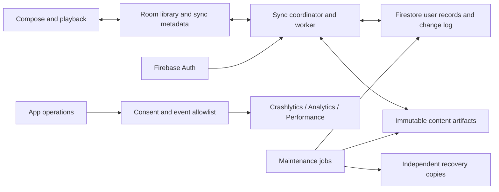

# Firebase sync and telemetry implementation plan

Date: November 4, 2026

Status: Incremental sync implementation merged to `main`; owner-selected deployment is Spark with local-only transcripts. Queue/preferences sync is available; paid content deployment is cancelled. Operational recovery/account lifecycle/telemetry gates remain open.

Current usage/configuration is documented in the [library sync guide](subscription-sync.md), with source/release/device boundaries in [implementation status](implementation-status.md). The dated checkpoints below preserve their original evidence. Release configuration injection is now implemented; broader release/operations acceptance and live telemetry remain open.

Scope: Optional account-based, offline-first library synchronization and privacy-controlled diagnostics/usage analytics for the native Android app.

Method: Test-driven development (TDD), with separate evidence for local tests, Firebase emulator tests, and live service acceptance.

## Owner constraint — Spark only, November 4

The owner explicitly declined Blaze and chose local-only transcripts. Billing was unlinked and verified disabled with no billing account linked. Do not enable billing again without explicit authorization. Production builds disable the paid content extension regardless of client bucket configuration. Queue and portable preferences can use protocol 2 with Firestore on Spark; transcript/analysis/conversation/explanation text remains local and transferable through the existing manual backup. The Storage implementation and emulator tests are retained as inactive development work, not an enabled product feature.

## How to read this plan now

The architecture and unchecked gates below describe the original broader plan.
They do not authorize enabling its cancelled paid-content milestone. Current
Spark capabilities include protocol-2 queue/preferences and protocol-3 contextual
moments. App Check remains [planned](app-check-rollout.md); telemetry, complete
account erasure and independent cloud recovery remain unimplemented. Use the
[usage and compatibility guide](subscription-sync.md) for the deployed scope.

## Extended portable-library increment — November 4 (historical checkpoint)

Implementation now includes versioned queue order and per-key portable preferences, immutable compressed finished-content artifacts, account/generation-scoped Storage rules, source/hash/size validation, atomic restore, and protocol-2 compatibility gating. Finished transcripts, completed analyses, conversation branches and explanations restore without regenerating AI/transcription. Existing source alternatives and active processing are preserved. Room schema 7 adds portable preference values and artifact staging state.

Local core/Room/security tests and two-client Android Auth/Firestore/Storage acceptance pass; final verification and live deployment are tracked in [TDD evidence](evidence/firebase-sync-tdd.md). Production content deployment was cancelled following the owner’s Spark-only decision above. Billing was unlinked before any full-content uploads; existing basic sync remains available. The queue/preferences option upgrades the account protocol independently of the disabled Storage adapter.

This increment does not complete the entire plan: account profile switching, broad alias/conflict/performance coverage, independent cloud recovery/retention/erasure, telemetry delivery, App Check and public release automation remain separate gates. Immutable objects/history are retained; do not enable pruning until recovery and old-device tests pass.

## Core-library increment — November 4 (historical checkpoint)

The branch now extends subscription sync to significant listening progress, separate completion actions, minimal episode restoration and saved moments. New TDD cycles cover periodic coalescing, rewinds, in-flight checkpoints, visible revision versus remote conflict candidate, paused/stopped handoff, restoration without jobs/downloads, moment deletion and source privacy. Validation: 205 JVM tests, 20 rules tests, 40 ordinary Android tests, 11 targeted Android tests and two individual process-restart invocations passed. Room schema 6 retains visible revisions and active session/checkpoint metadata. Detailed validation and outstanding limits are recorded in [TDD evidence](evidence/firebase-sync-tdd.md).

Live Google account selection/token exchange and empty-library server sync succeeded on the visible emulator, with cached sign-in verified after process restart. An independent test-only Android emulator runs synthetic Auth/Firestore acceptance; fixtures are never installed in the live account's library. The owner's physical phone remains on the saved pre-Firebase build.

This increment does not complete P6: recoverable account profiles, broader source-alias/fingerprint handling and the full acceptance/performance matrix still need work. Telemetry SDK integration and the later full-data/backups/erasure/release milestones remain open. Billing remains disabled.

## Subscription milestone checkpoint — November 4 (historical)

Implemented after foundation commit `cee4a3d`: native Google sign-in integration; one-account library binding; subscription eligibility/review; atomic follow/unfollow intent; Firebase server transactions; bounded worker/retry/bootstrap/cursors; explicit conflict choices; Settings controls and fresh-library restoration. Existing/manual feeds require selection; directory follows establish public provenance. Private tokens in URL paths are not inferred from URL shape.

Room schemas 4/5 add bindings, remote versions/cursors, outbox states and public-feed provenance, with tested upgrade paths from schemas 1–4. The current configured build is a developer alpha, not a published release. Default builds have no production Firebase configuration.

Validated: 190 JVM tests; 15 rule tests; ordinary Android suite with 38 passes and no skips; nine targeted SDK/UI/migration/isolation tests plus separate successful seed/resume invocations across a real force-stop. The two SDK clients have independent Firebase auth instances and Room databases on one Android emulator, not two physical phones. See the [TDD receipt](evidence/firebase-sync-tdd.md).

External setup: Google provider enabled by the owner; retained certificate fingerprints registered; free-tier Standard database created in São Paulo with deletion protection; validated subscription rules deployed. Billing remains disabled. Live Google account selection/login and a real-phone signed upgrade remain unverified. No Firebase build was installed on an owner phone, and no personal library was uploaded.

Remaining includes multiple local account profiles, all other portable data, independent backups/account erasure/retention, telemetry SDKs and live ingestion, App Check/live staging, release configuration and broader rollout. Existing full-phase checkboxes stay open until their complete acceptance criteria pass. See the [subscription milestone guide](subscription-sync.md).

## Initial foundation checkpoint — November 4 (historical)

Starting source: `a1e8456afdab0c9d9206235951abfe9a2a65cbd6`, with the previously prepared lock-screen changes preserved separately in the working tree.

- Implemented/tested: optimistic version decisions and tombstones, bounded payload validation/retry delay, typed consent gate, Room schema 3 outbox with atomic mutation/intent helper and scoped acknowledgement, Firestore transaction/rules feasibility harness and a CI job.
- Provisioned: authorized project `distillpod-native-sync` and Android app registration. Billing, Firestore region/database, production rules, authentication provider and live telemetry have not been activated.
- Validation: see the [TDD receipt](evidence/firebase-sync-tdd.md). Local unit/emulator tests do not demonstrate live device synchronization or cloud telemetry delivery.
- Remaining: Android Firebase transport, bootstrap/cursors, repository wiring, account/profile isolation, UI, SDK adapters, all entity-specific policies, artifacts, deletion, independent backups and release/operations gates. Existing phase checkboxes remain open until their complete acceptance criteria pass.

## 1. Outcome and delivery boundaries

Sign in once with Google to connect a DistillPod sync account. Keep using the app offline. Changes survive process death and synchronize automatically when Android permits network work. Signing into another phone restores the portable library without selecting a Drive folder or file. ChatGPT authorization remains a separate, device-local provider connection.

The original full-feature scope included subscriptions, listening progress, completion, saved moments, queue, portable preferences, finished transcripts, summaries/chapters/ad ranges, conversations and stored research. The current owner-selected scope excludes cloud transcript/analysis/conversation/research storage; those remain local. Downloaded audio, models, credentials and active processing/playback remain local. Restore must explain those exclusions.

Telemetry provides crash diagnostics, transcription/playback/sync reliability measurements, and aggregate feature usage without collecting content. A signed-out user can continue using the local app. A cloud outage does not block playback, capture, local transcription or access to downloaded data.

### Delivery milestones

| Milestone | User-visible result | Completion boundary |
| --- | --- | --- |
| A: observability | Optional diagnostics and usage analytics; actionable error reports | Crashlytics/NDK, lifecycle events, consent controls and redaction verified |
| B: core sync alpha | Sign-in; subscriptions, progress, completion and saved moments follow the account | Full fault/retry/account-isolation suite passes; partial-restore scope is explicit |
| C: complete portable library | Queue, preferences, finished generated content and conversations restore | Complete content manifests, account deletion and independent recovery tested |
| D: release and operations | Signed upgrade, documented recovery, cost monitoring and staged rollout | All gates in section 12 pass; no unchecked required tasks |

Milestone B is not the completed task. All phases below are required for the full feature unless explicitly marked optional. Milestones permit small releases without implying that unsynchronized content has been backed up.

## 2. Baseline and decisions

At the plan baseline, the app used Room 2.7.2 with database schema version 2. `AppDatabase.kt` contains relational entities and flows used by playback, library and AI repositories. Episode rows combine portable progress with device-specific download fields. Transcript rows combine content identity and local job state. `LibraryBackup.kt` imports missing records; it is not a conflict-aware sync mechanism. The existing implementation plan is historical; this document defines the optional cloud extension.

| Decision | Selected approach | Reason / boundary |
| --- | --- | --- |
| Local storage | Preserve Room and its relational queries | Complete offline library and transactional local writes |
| Identity | Firebase Auth with Google sign-in | Optional sync identity, separate from ChatGPT; other providers later |
| Cloud state | Firestore Standard, user-scoped documents | Managed storage, transactions and change delivery |
| Reliable change delivery | Room outbox plus bounded sync worker | Room and Firestore cannot commit atomically together |
| Crash diagnostics | Crashlytics including NDK | Android crashes, supported ANRs, nonfatal failures, native Whisper symbols |
| Performance | Firebase Performance custom traces | Aggregate bounded operation timing; not a durable job history |
| Usage | Google Analytics for Firebase | Explicit allowlisted events; no session replay or content capture |
| Large completed content | Immutable Cloud Storage artifacts with Firestore manifests | Bounded memory and document sizes; enabled in milestone C |
| Maintenance | Small Firebase Functions jobs where needed | Durable account deletion, retention/cleanup and recovery tasks; no hosted transcription or AI |
| Backup | Independent dated cloud recovery plus existing manual export | Sync propagates deletion and cannot serve as its own backup |
| Alternatives | No Supabase, PowerSync, Sentry or PostHog dependency initially | Keep operational scope focused; record portability tradeoffs |

**Billing boundary:** milestones A/B are designed to work on Spark without Cloud Functions or Cloud Storage. Milestone C's object storage, maintenance and managed backups require a billing-enabled project and may incur charges. Write and validate that deployment configuration before activation; account/project access and any paid-service authorization must be resolved at that point. Planning does not enable billing. If billing remains unavailable, deliver A/B honestly and leave C/D blocked on that dependency, not silently reduced to metadata-only sync.

Firebase pricing and SDK compatibility must be rechecked at implementation. Pin reviewed versions in the build and lockfiles. Do not upgrade Room solely to integrate Firebase. PowerSync's current Room adapter is beta and requires Room 3; revisit it only if the chosen protocol fails its feasibility gate.

## 3. Architecture and invariants



Required invariants:

1. Every user mutation is durable locally before success is shown. The same Room transaction records its sync intent.
2. The UI reads Room. Firestore callbacks never mutate player state directly or become a second UI data source.
3. Each queued mutation is bound to one account/library generation, device and operation ID. A changed auth session cannot send an earlier account's work.
4. A successful remote commit is safe to retry after process death. Local acknowledgement happens only after confirmed server acceptance, not an SDK cache callback.
5. Incoming updates and pull cursors commit together in Room. Pending local edits survive remote pulls; keep remote base state separately from the optimistic local projection.
6. Deletion is represented explicitly. Stale devices cannot recreate deleted content through blind upsert.
7. Neither local file paths, credentials nor runnable jobs appear in portable cloud records.
8. Restoring content never starts AI requests, transcription, downloads or playback automatically.
9. Telemetry failure cannot fail a user operation. Telemetry is bounded and independent of the library outbox.
10. An account is isolated by Firebase UID and server-checked rules, not by trusting an owner field supplied by the client.
11. Sync disabled, auth expired, Android force-stop and no connectivity are truthful states; none are described as successful synchronization.
12. All tests use synthetic libraries/public fixtures. No owner data enters Git, logs, CI artifacts or test projects.

### 3.1 Local schema and seams

Add versioned migrations, preserving existing IDs and relationships. Proposed structures (exact names may change during implementation):

- `sync_bindings`: local library identity, bound Firebase UID, account generation, device registration and bootstrap state.
- `sync_outbox`: operation ID, owner generation, entity key/type, base revision, bounded payload/reference, device sequence, state, attempt and retry classification.
- `sync_remote_state`: last acknowledged remote version and base payload, separate from pending local projection.
- `sync_cursors`: owner generation, cloud epoch, applied change sequence and bootstrap checkpoint.
- `sync_conflicts`: both alternatives, their provenance, resolution state and actionable type.
- `sync_artifacts`: immutable revision, hashes, transfer checkpoints, publication state and local verified cache reference.
- `sync_job_journal`: bounded local operational records for interruption diagnosis; no content or credentials.

Introduce `SyncRepository`, `CloudSyncTransport`, `SyncCoordinator`, `SyncIdentity`, `TelemetrySink`, `Clock`, and failure-injection seams. Keep merge/protocol rules in `core`; Android scheduling, Room and Firebase adapters stay in `app`.

Do not build unrestricted dual writes into each repository. Route portable mutations through transaction helpers, including imports and job-completion transitions. Audit every existing DAO mutation: mark it local-only or cover its sync intent. Raw backup imports require a reconciliation hook.

### 3.2 Cloud protocol proposal and mandatory feasibility gate

Use `/users/{uid}/...` with an account control record, versioned portable entities, immutable operation receipts, immutable ordered change entries, and artifact manifests. All records include a schema/protocol version. Cloud entity keys must be safe path segments; never use raw feed URLs as document paths.

For the small initial user library, a per-user monotonically increasing commit sequence supplies reliable pagination. It is not a global counter shared by every user. It serializes commits within an account, so contention and operation cost must be measured in phase P1.

Upload one bounded logical entity operation per Firestore transaction:

1. Read account generation/status, operation receipt and current entity version before any writes.
2. If a matching receipt exists, return its result; reject reuse of an operation ID with a different payload hash.
3. Compare the expected base version and apply the entity's conflict rule. Do not turn a stale update into a fresh edit by changing its timestamp.
4. Atomically update the portable record/tombstone, increment the account sequence, and write its immutable change entry and operation receipt.
5. Acknowledge only that operation locally. An edit made while the upload was in flight remains pending and is rebased as a distinct operation.

The change entry contains a bounded portable envelope, or an immutable artifact reference for large content. Chunk/blob transfers are staged; publishing the manifest is a separate idempotent logical operation. Never store unrestricted transcript text in receipts or change entries.

A rejected stale operation becomes a durable conflict, not an endless retry or a discarded edit. Resolving a conflict creates a new operation against the latest confirmed base version. If that base changes again, preserve the alternatives and repeat resolution. Feed-refresh or automatic job completion must not masquerade as an explicit user conflict resolution.

Firestore transactions require connectivity. Offline user writes therefore finish in Room, with the coordinator attempting the transaction later. Treat SDK persistence as an implementation detail rather than a second authoritative retry queue. Test cache/network transitions explicitly.

Pull immutable changes in sequence order with bounded pages. Checkpoint only after applying a page transactionally. Listener callbacks are wake-up hints; a durable cursor is the recovery mechanism. A missing sequence, expired epoch, unsupported protocol or retention gap forces a deliberate rescan rather than silently skipping records.

Bootstrap: record a cloud high-water mark; page canonical entities by stable key, retaining tombstones and per-entity sequence; then replay changes after the mark. Reject older versions when pages and changes overlap. Upload pre-existing local content only after this merge, avoiding first-login overwrite of an established cloud library.

Retain tombstones and receipts in the initial alpha. Before pruning, implement account epochs, a documented supported offline interval, and safe rebase of old pending operations. Never add TTL deletion to these records without stale-device tests. Maintenance must avoid unbounded history growth before broader rollout.

**P1 gate:** prove this protocol with real Firestore emulator transactions and security rules. Rules must enforce owner, generation, expected version and the required companion writes, within Firestore's access-call limits. Measure contention and read/write amplification. If correct rules or acceptable performance cannot be achieved, move the commit transaction into a small authenticated backend endpoint and revise the billing/deployment plan. Do not relax integrity rules to keep Spark compatibility.

### 3.3 Portable data and conflict policy

| Data | Portable representation | Concurrent-change policy |
| --- | --- | --- |
| Subscriptions | Stable feed identity/aliases, display metadata, follow state | Stale updates cannot defeat an unfollow tombstone. An explicit re-follow references the current tombstone version |
| Episode identity | Feed-scoped GUID and source provenance; minimal metadata needed to restore saved items | Preserve existing identity; alias mapping handles public feed moves. Never identify an episode by title alone |
| Position | Session/device ID, logical sequence, base revision, original milliseconds | Preserve candidates when two offline sessions diverge. Offer “Continue from this phone / other phone”; no max-position or wall-clock-only merge |
| Completion | Explicit complete/incomplete action, separate from automatic near-end detection | Stale auto-completion cannot override a later explicit “mark unplayed” |
| Saved moments | UUID, original interval, excerpt, completed insight and provenance | Duplicate retries collapse; deletion wins against stale generation completion. Preserve incompatible user edits as a conflict |
| Queue | Versioned ordered unique episode IDs | Atomic whole-queue update initially. Concurrent reorder retains a conflict and offers either version; keep active playback stable |
| Preferences | Per-key allowlist | Independent keys merge; incompatible edits of the same key retain the local choice until resolved |
| Transcripts | Immutable revision + media fingerprint + language/model/source + timed segments | Different audio/revisions coexist; never apply timestamps to a mismatched enclosure. Partial computation checkpoints stay local |
| Analysis/research | Completed immutable result, input revision, provider/model/prompt metadata | Distinct results coexist; selection references a revision; no automatic regeneration |
| Conversations | Stable message IDs, reply links, completed content and provenance | Preserve concurrent branches; stable ordering/tie-break; no fabricated assistant completion for an interrupted request |
| Suggestions | Portable dismissal choices; optional cached recommendations | Rebuildable suggestions can expire; explicit dismissal remains portable |

Credentials embedded in private feed/media URLs are credentials too. Initially keep credential-bearing/private source locators local, show the exclusion and require reconnection on a new device. Do not strip query parameters blindly, upload tokens, or claim those sources are fully restored. Public URL canonicalization must preserve meaningful parameters.

### 3.4 Identity, consent and device lifecycle

- Initial sign-in shows the target Google account and explains that enabling sync uploads portable library content. Sync consent is separate from analytics and diagnostics.
- Use one active account library at a time. Namespace/isolate account-owned local data, caches, outboxes and workers. Preserve the original local-only library as a recoverable profile during first binding.
- Signing out stops workers/listeners, clears SDK auth and cross-account caches as appropriate, and keeps a clearly labeled offline copy. Signing into B must never upload A's retained library automatically. Switching accounts pauses active jobs/playback before switching the active library; no records are cleared as a shortcut.
- Reauthentication resumes the same pending work. Account deletion revokes the cloud generation so old devices cannot recreate it. New sign-in after deletion creates a fresh account/library binding.
- “Pause sync”, “Sign out”, “Remove cloud data/account” and “Remove local downloads” are distinct actions. Destructive actions have explicit UI confirmation.
- Diagnostics and usage collection default off until chosen. Verify SDK initialization behavior, persisted consent and revocation; never assume suppressing our wrapper disables SDK auto-collection.
- Cloud data is access-controlled and encrypted in transit/at rest by the service; this plan does not promise end-to-end encryption. Document that distinction when enabling cloud sync.

## 4. TDD workflow and test architecture

For each task below, write the behavior test first, run it and record a failure caused by the missing behavior. Implement the minimum production change, get green, then refactor with tests green. A compilation failure alone is not the final red evidence once the necessary interface exists. For a bug, preserve a failing reproduction before fixing it.

Record red command/result, green command/result, relevant source revision and test layer in `docs/android/evidence/firebase-sync-tdd.md` during implementation. Do not create fictional pass results now. Run the relevant suite after refactoring and the complete required suites at milestone gates. Test behavior and failure boundaries, not private method names or implementation snapshots.

| Layer | Purpose | Tools / isolation |
| --- | --- | --- |
| Core JVM | Merge rules, protocol state machine, consent, retry policy, invariants | JUnit, deterministic clocks, controlled coroutine scheduling, seeded operation permutations |
| Android/Room | Atomic outbox, migrations, actual persistence and worker lifecycle | Isolated instrumentation databases and Android emulators |
| Firebase rules | Unauthorized access, invalid payloads, atomic companion writes | Firebase Emulator Suite + rules unit testing; pinned Node/CLI dependencies |
| Transport integration | Real transactions, listeners, pagination, duplicate commits, contention | Auth/Firestore emulators, synthetic users A/B and devices 1/2 |
| Artifact/maintenance | Storage access, staged uploads, deletion, retention, restore | Storage/Functions emulators plus staging tests for unsupported emulator behavior |
| UI acceptance | Sign-in states, consent, restore, conflicts, accessibility | Compose instrumentation and synthetic library |
| Live staging | OAuth, signed APK attestation, native symbolication, SDK uploads, billing metrics | Dedicated test project and test accounts; never production fixtures |
| Physical smoke | Signed upgrade, real lock/idle/reconnect behavior | Preserve phone data; no owner uninstall/clear or destructive fixture tests |

Cloud emulators cannot prove live OAuth, Play Integrity, Crashlytics delivery, GA4 reporting, managed backups, real quotas or Android background delivery. Those receive explicit staging/manual evidence. Local analytics tests assert our event contract, not Google's dashboard internals.

## 5. Implementation task breakdown

Dependencies: P0 → P1 → P2 → P3. P4 telemetry can proceed after P0; P5 starts after P1/P2; P6 needs P3/P5. P7–P9 build on core sync. P10 and P11 complete before P12. This order does not require parallel agents.

### P0 — Baseline, fixtures and implementation boundaries

- [ ] Record the actual starting commit and existing dirty work; preserve the current lock-screen changes independently.
- [ ] Inventory portable mutation paths in repositories, playback service, imports and AI completion handlers.
- [ ] Build synthetic fixtures covering two devices, two accounts, feed aliases, completed/partial transcripts, conversations and local downloads.
- [ ] Define protocol/telemetry interfaces and typed identifiers in `core` without Firebase dependencies.
- [ ] Add explicit local/emulator/staging/production configuration separation; default test builds cannot contact production.
- [ ] Establish baseline Kotlin, release-tool, lint and existing device-test results.

**Red tests first:** serializer rejects credentials/device paths; local operations succeed with a throwing cloud adapter; test environment rejects a production project ID.

**Gate:** baseline failures are understood and isolated; no unrelated data loss or regression is concealed.

### P1 — Protocol, merge rules and Firebase feasibility

- [ ] Specify wire envelopes, schema versions, maximum sizes, ordering, operation hashes and receipt behavior.
- [ ] Implement deterministic merge policy for each row in section 3.3 and conflict storage contracts.
- [ ] Create Firebase emulator configuration, rules/index files and fixture helpers under `firebase/`.
- [ ] Prove atomic record + counter + change + receipt writes using Firestore transactions and adversarial rules tests.
- [ ] Measure rules document-access counts, transaction retries, per-account contention and read/write costs.
- [ ] Test conflict resolution racing another change; preserve local pending edits when the cloud base advances and distinguish rejected operations from retryable transport failures.
- [ ] Exercise stable-key bootstrap plus change replay while a second client adds, modifies and deletes records.
- [ ] Document whether the direct-client protocol passes; resolve the backend-endpoint fallback before expanding implementation.

**Red tests first:** same operation delivered twice; operation ID reused with changed content; stale revision; delete versus stale update; re-follow; concurrent rewind/progress; changed device clock; competing queue orders; two concurrent writes allocating sequences; denied partial companion writes; crash after server commit before acknowledgement.

**Gate:** two emulator clients converge or expose an explicit preserved conflict; no silent loss, duplicate logical operation or cross-account access.

### P2 — Room migration and durable local writes

- [ ] Add schema migration(s), exported schema fixtures and account/profile ownership.
- [ ] Add outbox, remote bases, cursors, conflicts, artifact state and bounded local journal.
- [ ] Route every portable write through the atomic helper; explicitly classify local-only writes.
- [x] Coalesce unsent progress updates without modifying an operation already in flight; acknowledge by operation identity/version.
- [ ] Make imports and first sign-in baseline enumeration crash-safe and idempotent.
- [ ] Handle disk-full/database failure without reporting a saved or synced action that was not persisted.

**Red tests first:** upgrade schema 2 with a populated fixture; rollback between library and outbox insert; kill/reopen database; new edit during acknowledgement; incoming pull with pending local edit; migration failure preserves original database; download progress produces no sync mutation.

**Gate:** local library, files, model state, queue and provider credentials survive upgrade; every portable mutation has durable intent.

### P3 — Sync worker, transport and recovery

- [ ] Implement bounded push/pull, connectivity constraints, exponential backoff with jitter, unique work and cancellation.
- [ ] Trigger on local edits, foreground entry, sign-in and network opportunity; use periodic work as recovery, not a promise of exact timing.
- [ ] Handle auth expiry, permission denial, quota/rate limits, unavailable service, malformed data, protocol mismatch and missing artifacts distinctly.
- [ ] Recover after process death/reboot; after force-stop recover when reopened. Do not add a permanent foreground sync service or polling loop.
- [ ] Implement bootstrap, cursor persistence, conflict retention, listener detach and stale-generation checks.
- [ ] Define status from server acknowledgements and verified downloads; cached reads cannot alone produce “Synced”.
- [ ] Bound work per run and yield around playback/transcription; prefer Wi-Fi for bulk content with an explicit user override.

**Red tests first:** network disappears at every transaction boundary; cursor apply rollback; duplicate listener event; out-of-order event; bootstrap pagination under concurrent edits; quota exhaustion; denied rules; reboot; auth swap during callback; stale worker after sign-out; unsupported schema; retry budget exhaustion.

**Gate:** convergence after permitted reconnection/relaunch, bounded retry/resource use, durable pending changes, no effect on audio continuity.

### P4 — Consent, telemetry and diagnostic instrumentation

Current direction: the [Sentry diagnostics candidate](cloud-diagnostics.md) replaces the proposed Firebase telemetry adapters below. The original unchecked requirements remain evidence of outstanding scope; they are not implemented merely by adding Sentry. Live delivery is pending.

- [ ] Add typed allowlisted event APIs and separate diagnostics/usage preferences with collection disabled before consent.
- [ ] Integrate Crashlytics and NDK reporting, release build identity, R8 mapping and native symbol upload.
- [ ] Integrate Analytics explicit events; inspect/disable unwanted automatic collection, advertising identifiers and sensitive screen/URL attributes.
- [ ] Add bounded Performance traces for operations/chunks, using monotonic durations; no unbounded trace spanning an entire multi-hour job.
- [ ] Instrument transcription checkpoints, interruption/recovery, playback failures, capture outcomes and sync failures with safe reason codes.
- [ ] Reconcile interrupted job journal entries on next launch. A start without a finish is an interruption candidate, not automatically a crash or failure.
- [ ] Ensure revocation stops future collection and handles queued reports according to each SDK's supported API; document deletion/retention limitations.
- [ ] Build dashboards in section 7 and verify denominator/deduplication rules against fixtures.

**Red tests first:** fresh install sends nothing; consent before/after SDK initialization; revoke with queued events; allowlisted event shape; sensitive strings in exceptions/URLs; repeated callbacks count completion once; duration with wall-clock change; crashing telemetry adapter; bounded journal; process death before terminal event.

**Live acceptance:** synthetic Kotlin crash, nonfatal error and native crash appear with readable symbols in staging; API-supported ANR and custom trace tests; analytics events appear without content. Emulator/fake tests alone cannot check these boxes.

**Gate:** collection matches consent; no sensitive payload leakage; observed reports identify release, stage and actionable reason.

### P5 — Firebase projects, authentication and access control

- [ ] Provision separate staging and production projects when project access is available; record IDs/region/IAM ownership outside secrets.
- [ ] Select Firestore region deliberately for users/latency/cost and future artifact/function co-location before provisioning.
- [ ] Configure Google sign-in with debug/staging and retained release certificate fingerprints; include future Play App Signing certificate when applicable.
- [ ] Implement optional Google sign-in, cancellation, account chooser, reauthentication and recoverable errors using current Android-supported APIs.
- [ ] Deploy deny-by-default, user-scoped Firestore rules and required indexes; test schema/type/size/version validation and malformed writes.
- [ ] Configure App Check for the current sideloaded signed APK distribution. Test before enforcement; production must not ship a debug provider/token.
- [ ] Separate client Firebase configuration from privileged deployment credentials; service-account keys never enter the APK or repo.
- [ ] Use narrowly scoped deployment identity and CI environment controls; pin Firebase tooling.

**Red tests first:** unauthenticated read/write, A accessing B, spoofed owner, account generation mismatch, forbidden fields, oversized documents, invalid sequence/receipt, direct delete bypass, missing companion writes and unauthorized artifact manifests. Test query/list access as well as known document IDs.

**Live acceptance:** Google login and refresh, canceled login, signed sideload App Check, cold start after token expiry, sign-out/account switch.

**Gate:** real signed client works; invalid clients/users are denied without disabling isolation rules.

### P6 — First sync, core entities and settings UI

- [ ] Build Settings → Account & sync: account, enable/pause, pending count, last confirmed sync, retry and actionable error states.
- [ ] Add a first-enable explanation and merge summary for an existing cloud/local library; preserve a recoverable local checkpoint.
- [ ] Sync subscriptions, episode identity, progress/completion and saved moments with minimal restoration metadata.
- [ ] Add conflict presentation for divergent progress and moment edits; playback continues on the active device until the user chooses.
- [ ] Add fresh-phone restore progress, offline fallback, interrupted resume and honest partial milestone-B coverage.
- [ ] Handle private feed exclusions and provider/model reconnection needs clearly.
- [ ] Cover TalkBack, font scaling, small displays and slow/offline states; keep implementation details out of product text.

**Red tests first:** new account with existing local library; populated cloud plus local-only edits; duplicate feed alias; fresh phone; offline sign-in attempt; first upload killed halfway; restore restarted; consent declined; conflict action; disabled sync; error accessible by TalkBack.

**Gate:** two isolated Android clients exchange core data without a picker, preserve existing records and expose all pending/conflict/error states accurately.

### P7 — Queue, preferences and account lifecycle

- [ ] Sync queue as a versioned ordered list with deterministic deduplication and explicit concurrent-order resolution.
- [ ] Restore unresolved episode references using portable metadata; queue items remain meaningful if a feed changes or disappears.
- [ ] Sync per-key portable preferences; keep storage/network policies, active playback and provider identity local.
- [ ] Implement account profile switching, retained offline copies and explicit removal of a local profile.
- [ ] Verify sign-out/pause stops future uploads and stale asynchronous callbacks cannot cross an account boundary.

**Red tests first:** concurrent queue reorder, deleted episode reference, huge queue bounds, restoring while another episode is playing, preferences changed on both devices, A → signed out → B → A, background AI result during switch, and old listener arriving after switch.

**Gate:** no cross-account upload or UI exposure; queue conflicts preserve both choices; incoming sync does not unexpectedly seek/start playback.

### P8 — Finished transcripts, analyses and conversations

- [ ] Enable the reviewed billing-dependent storage configuration only when its deployment prerequisites are satisfied.
- [ ] Define versioned artifact format with bounded compressed/uncompressed sizes, segment count, hash, media fingerprint and model/language provenance.
- [ ] Upload immutable account-scoped artifacts with resumable checkpoints; publish references only after successful upload verification.
- [ ] Download to staging files, validate checksum/schema/size, then import atomically. Interrupted or invalid files never replace a valid local revision.
- [ ] Sync completed summaries, chapters, ad ranges, explanations/research and conversation branches; interrupted attempts remain clearly incomplete/local.
- [ ] Select compatible transcript revisions; never attach timings to different dynamically inserted audio.
- [ ] Add bulk restore policy, progress and cancellation; record pending artifact count independently from metadata sync.
- [ ] Add orphan upload cleanup with a grace period longer than the supported upload interruption window; preserve referenced/backup-protected objects.

**Red tests first:** artifact > Firestore document limit uses object storage; interrupted upload before/after manifest; wrong hash; decompression bomb; wrong account; missing blob; stale completion after moment deletion; two models on same episode; changed audio fingerprint; interrupted AI stream; concurrent chat branches; cancellation/restart.

**Gate:** a new phone can access verified finished portable content without rerunning AI/transcription. “Fully synced/restored” requires artifact completion.

### P9 — Independent backups, deletion and retention

- [ ] Define cloud recovery targets: daily recovery points, initial 30-day retention, and a documented per-user restore procedure. Measure actual costs before enabling that policy.
- [ ] Back up Firestore state and referenced artifact generations consistently; artifacts required by retained recovery points cannot be garbage-collected.
- [ ] Restore into an isolated staging namespace/database first, validate, then perform an explicit account restore with a new sync epoch. Do not replace production wholesale.
- [ ] Keep manual JSON/ZIP/OPML export usable, add new portable schema support, and preserve backward import compatibility with fixtures.
- [ ] Implement authenticated account deletion using a durable server-side job (or a verified extension plus completion tracking), recursive document/blob deletion and retryable checkpoints.
- [ ] Mark the account unavailable for writes before deletion; handle recent-login requirements, cancellation before acceptance and repeated requests. UI distinguishes “requested” from “completed”.
- [ ] Cover telemetry deletion separately where supported; state backup expiry and any service retention honestly in privacy UI/docs.
- [ ] Define device registration expiry and history compaction. Preserve initial tombstones/receipts until old-device rebase and epoch reset tests pass.
- [ ] Ensure account erasure suppresses restoration from old backups; operational restore must reapply deletion records before access is reopened.

**Red tests first:** corruption followed by dated restore; backup/metadata/blob mismatch; deletion worker killed halfway; deletion requested twice; offline old device reconnects after deletion; stale SDK token; deleted user bulk-admin path; artifact retained by backup; expired device with pending edits; restore creates an epoch gap.

**Gate:** independent recovery works and deletion completes despite the initiating phone disappearing. No data resurrection from stale devices or recovery operations.

### P10 — CI, deployment, cost and operational controls

- [ ] Extend CI with core protocol tests, Room migration tests, Firebase rules/transport tests and two-client acceptance.
- [ ] Provide a pinned `firebase emulators:exec` script and separate Android emulator configuration; use isolated demo project IDs and fail closed on production endpoints.
- [ ] Capture synthetic evidence only; ensure test logs do not print tokens, OAuth redirects or sample private URLs.
- [ ] Preserve the existing unsigned-validation → protected signing → release publication gates.
- [ ] Upload mapping/native symbols for the exact release candidate and record build IDs; keep privileged credentials out of ordinary PR jobs.
- [ ] Deploy compatible rules/indexes/functions before enabling a client protocol; test one-version-old clients and rollback/forward-fix paths.
- [ ] Measure operations, bytes and retries for the fixture workloads in section 8; monitor Firestore usage, function execution and storage growth.
- [ ] Configure budget alerts and applicable spend controls. Alerts alone do not cap charges. Limit bulk transfers/retries and disable unnecessary cloud jobs.
- [ ] Add a sync pause/kill-switch control that preserves local/outbox data, plus a minimum-protocol mechanism and clear recovery UI. Cached defaults must allow offline use.
- [ ] Write runbooks for quota exhaustion, rules/index mistakes, leaked deployment credentials, account deletion failure, damaged artifacts and cloud outage.

**Red tests first:** missing config, release pointing at staging, production endpoint in tests, incompatible protocol, denied rule rollback, replayed deployment job, telemetry enabled in test builds, symbol/build mismatch, kill-switch with pending edits, and bounded retries under prolonged quota errors.

**Gate:** fresh checkout can run the documented test suite; release cannot publish with failed required sync/security tests.

### P11 — End-to-end fault, performance and device acceptance

- [ ] Execute every scenario in section 6 using two isolated Android clients and synthetic accounts.
- [ ] Run existing player, download, backup, transcription, lock-screen, authentication and database-upgrade regressions.
- [ ] Use a verified public-speech fixture to test screen-off transcription while sync/telemetry work is queued; compare with baseline.
- [ ] Verify process death separately from force-stop and Android idle; document which conditions require reopening the app.
- [ ] Run staging service checks, cross-account erasure/restore, actual operation-cost measurement and signed build attestation.
- [ ] Perform a bounded physical-device signed-upgrade smoke test with preserved owner library/account/models/downloads; long playback or live AI tests require their established task authorization.
- [ ] Check accessible UI, large font, low storage, metered network, captive/unavailable connection and interrupted restore.

**Red tests first:** write each fault scenario as a failing acceptance test before the corresponding resilience implementation, rather than adding a green end-to-end suite only at the end.

**Gate:** no unexplained loss, duplication, account leakage, unwanted AI execution or playback interruption; unverified physical/service behavior remains explicitly open.

### P12 — Documentation, rollout and completion

- [ ] Update README, getting-started guide, privacy policy, backup guide, development commands and release notes to describe delivered behavior only.
- [ ] Document cloud content handling, optional consent, local-only credentials/audio, account deletion and billing limits. Prepare accurate store data disclosures if a store release is pursued.
- [ ] Add production dashboard links, project ownership, recovery instructions and maintenance responsibilities to the appropriate private operational record; no credentials in Git.
- [ ] Start with staging, then a small signed alpha with sync optional; verify ingestion, cost, pending-age and error metrics before broader enablement.
- [ ] Publish an evidence receipt covering TDD, migrations, security, two-client convergence, artifacts, deletion, backup restore, live telemetry and device smoke.
- [ ] Commit/release implementation changes through the normal workflow when that delivery action is authorized; preserve signing identity and version upgrade continuity.
- [ ] Mark the feature complete only when milestones A–D and section 12 criteria pass.

## 6. Required acceptance matrix

Each scenario must have an automated assertion where feasible, with a separate live/device receipt where required. “Two clients” means independent local databases, installation IDs and auth sessions, not two views of one database.

| ID | Scenario | Required result |
| --- | --- | --- |
| S01 | Phone A edits offline, restarts, reconnects | Durable edits reach B once; local UI worked throughout |
| S02 | Server accepts, A dies before ack | Retry returns original receipt; no duplicate moment/change |
| S03 | B receives a page and dies before cursor commit | Whole page replays safely; no skipped update |
| S04 | Both phones change unrelated records | Both edits preserved |
| S05 | A deletes, offline B edits old version | Deleted item stays deleted; conflict is recoverable |
| S06 | Explicit re-follow after confirmed unfollow | New version accepted; stale re-follow rejected |
| S07 | A rewinds while B has newer/older progress | Intentional rewind preserved; ambiguous session choice explicit |
| S08 | Old near-end checkpoint arrives after mark-unplayed | Explicit incomplete state retained |
| S09 | Both reorder the queue | Both versions retained for resolution; no duplicates |
| S10 | Incoming progress/queue during playback | Current playback does not jump/start/stop unexpectedly |
| S11 | Fresh phone restore interrupted repeatedly | Resumes; portable record counts/hashes match; no AI invoked |
| S12 | Existing local library first binds to populated account | Merge without overwrite; checkpoint available |
| S13 | Sign out / switch accounts during upload and pull | No cross-account data transfer, callback application or UI exposure |
| S14 | Auth expires, rules deny, quota ends, server unavailable | Correct distinct state; bounded retry; no false “Synced” |
| S15 | Phone clock moves backward/forward | No ordering based solely on wall clock; durations remain valid |
| S16 | Same GUID in different feeds, moved feed, private URL | Identity retained; no token disclosure or title-based merging |
| S17 | Audio fingerprint changes or two transcript revisions exist | Correct timing/content pairing; incompatible versions not applied |
| S18 | Artifact missing/corrupted/oversized/incomplete | Valid local revision retained; recoverable diagnostic |
| S19 | Account deletion followed by stale device/backup restore | No recreation of erased account content |
| S20 | Cloud history compacted while device offline | Epoch mismatch triggers safe rebase; pending edits preserved |
| S21 | Malicious unauthenticated/cross-user/partial write | Rules deny; no metadata/listing leak |
| S22 | Consent off, revoked, or SDK auto-init occurs | No disallowed collection; queues handled as documented |
| S23 | Crash, native crash, supported ANR, interrupted job | Staging receives readable allowed diagnostics; interruption classified honestly |
| S24 | Low disk, process kill, reboot, force-stop, idle | Durable state preserved; recovery matches Android lifecycle limits |
| S25 | Schema upgrade, old client, feature disabled/rollback | Data readable/preserved or safe upgrade-required state; no destructive fallback |
| S26 | Large library and slow/metered connection | Bounded memory/work, responsive playback, resumable bulk content |
| S27 | Independent backup restore after synced corruption | Verified prior state recovered without restoring deleted accounts |
| S28 | Retry/duplicate/abandoned operation in analytics | Metrics do not count one logical completion twice; denominators explicit |

Add seeded permutation tests for merge idempotence, convergence for conflict-free edits, monotonic revisions, tombstone safety, account isolation and preservation of unresolved alternatives. Keep the failing seed when a regression is found.

## 7. Telemetry contract and dashboards

Diagnostics and analytics are separate streams. Use bounded categorical values for aggregate metrics; avoid high-cardinality operation IDs as GA4 dimensions. Random operation IDs may join safe local journal entries and diagnostic reports where supported, but are not a promise of complete distributed traces. Crashlytics logs are bounded crash context, not a general searchable event store.

| Event family | Allowed examples | Metrics |
| --- | --- | --- |
| Transcription | started, checkpoint, paused, resumed, completed, failed; safe stop reason, model family, language, foreground/background, elapsed/audio duration buckets | Completion/interruption rates, recovery rate, processing time per audio minute by model/device class |
| Playback | started, buffering threshold exceeded, failed; categorical source/network/error | Failures per playback session, buffering frequency |
| Distill | captured, waiting, completed, failed; lock-screen/in-app origin | Capture durability, completion rate, time to ready |
| Search | performed, results bucket, result selected, followed; duration | Empty-result rate and search-to-follow conversion without query text |
| Sync | batch completed/failed, conflict, bootstrap completed; counts/bytes/duration buckets, oldest pending-age bucket | Pending age, failures by reason, convergence latency and restoration success |
| App usage | explicitly approved screen/feature names and app version | Active users, retention and feature adoption |

Forbidden: audio, transcripts, quotes, chat text, prompts, raw search queries, podcast/feed/media URLs, titles revealing listening history, OAuth fields, tokens, email, raw exception messages containing user data, local paths, screenshots and session recordings. Hashing a sensitive URL is not sufficient anonymization.

Tasks include exception sanitization before SDK recording, review of native crash/report metadata, network URL collection review, and documented provider retention/deletion settings. Disable specific automatic telemetry if sensitive URLs cannot be reliably excluded. Content sync consent does not authorize sending that content to analytics.

Define dashboard denominators explicitly: e.g. started transcription attempts, completed logical jobs and recovered attempts are different measurements. A consented-user dashboard is a sample, not the entire install base. Missing terminal events are not silently counted as success. Rate-limit repeated errors and sample performance traces deliberately.

## 8. Performance, capacity and cost gates

Proposed acceptance workloads (synthetic, fixed seed):

- Small: 30 subscriptions, 100 significant progress records, 100 moments, two devices.
- Large: 200 subscriptions, 10,000 locally cached episodes, 5,000 moments, multiple completed transcript artifacts and conversation branches. Do not sync every refreshed RSS episode by default.
- Adversarial: 1,000 pending edits, repeated network flaps, concurrent writes, expired auth and 24 hours of simulated retry scheduling.

Measure local mutation latency, foreground responsiveness, peak memory during restore, operation counts including rule reads/receipts/change entries, bytes transferred, worker duration, retries and battery impact relative to baseline. Establish numeric regression budgets in P1 from measured baseline before accepting implementation; do not invent benchmark results.

Initial policy: local progress remains frequent for crash recovery; cloud progress coalesces to at most one periodic checkpoint per active session per 30 seconds, plus meaningful pause/seek/completion boundaries. Coalesce rapid scrubbing. When offline, compact superseded unsent checkpoints, retaining conflict/explicit-action semantics. Validate whether this cadence meets handoff expectations and free quotas.

Firestore's free allowance is for database operations, not user actions: one safe commit can require multiple reads and writes. Large transcript artifacts are excluded from document payloads. Bound change retention and backups deliberately; free-tier estimates must include monitoring/export/storage/function overhead. Scheduled backups and object storage are not promised to remain free.

No exact background convergence deadline is promised under Android idle/force-stop. In controlled foreground staging tests, record time-to-convergence on a healthy connection and investigate regressions. During cloud quota/outage conditions, the expected behavior is durable local progress and truthful pending status.

## 9. Proposed repository changes during implementation

```text
core/src/main/.../sync/           Protocol, merge policies, payload validation
core/src/test/.../sync/           State-machine and property/permutation tests
app/src/main/.../sync/            Room adapters, coordinator, Firebase transport
app/src/main/.../telemetry/       Consent, typed events, SDK adapters
app/src/main/.../features/        Account/sync, restore and conflict UI
app/src/androidTest/.../         Migrations, two-client and lifecycle acceptance
firebase/                       Rules, indexes, emulator config, deployment notes
firebase/tests/                 Security and transaction integration tests
firebase/functions/             Required deletion/maintenance jobs for milestone C
scripts/                        Reproducible cloud emulator and acceptance runners
.github/workflows/              Validation and controlled deployment integration
docs/android/evidence/          Synthetic TDD and acceptance receipts
```

Paths are proposals, not claims that these files exist. Keep Firebase imports out of core. Update `docs/development.md` with actual implemented commands, pinned toolchain prerequisites and emulator ports. The current JDK 17 Android build may coexist with a separately pinned Java runtime if the selected Firebase emulator requires it; verify rather than silently changing the Android toolchain.

## 10. External setup and unresolved inputs

Resolve these during implementation without blocking local TDD:

| Input / decision | Default / action | Gate |
| --- | --- | --- |
| Firebase project/account access | Discover existing authorized projects; create/use dedicated staging and production only within authorized scope | P5 deployment |
| Region | Compare latency/cost for primarily Brazil-based use; co-locate database, storage and maintenance where supported | Before provisioning immutable locations |
| Billing | Spark-compatible A/B; C requires billing-enabled services and a reviewed cost estimate | Before paid-service activation |
| Test Google accounts | Dedicated synthetic test users; emulator identities for CI | Live OAuth/attestation acceptance |
| Release certificate | Retain existing app signing identity; register relevant fingerprints | P5/P10 |
| Offline retention horizon | Initial alpha retains receipts/tombstones; define horizon before pruning | P9/P10 |
| Private authenticated feeds | Device-local credentials and explicit restore exclusion initially | P6 documentation/UI |
| End-to-end encryption | Not included; explicit cloud content disclosure | Before sync consent is finalized |
| Public store distribution | Separate release goal; accurate privacy/data disclosures prepared | Public rollout if requested |

## 11. Rollout and rollback

1. Merge small, tested foundations behind disabled configuration. Ship no automatic personal data upload.
2. Validate emulator workflows, then live staging with synthetic data and signed builds.
3. Enable telemetry only after consent; verify redaction and readable symbols before diagnosing real issues.
4. Enable core sync for the initial alpha account only after a recoverable local checkpoint and full P6 gates.
5. Add complete content sync and operational recovery/deletion before describing the feature as a full portable-library replacement for manual restore.
6. Roll out more broadly after measured reliability/cost and complete acceptance evidence.

Rollback pauses cloud work and preserves local records/outbox. Prefer an application forward fix over installing an older APK against a newer schema. Keep old protocol/rule compatibility for the supported client window. A backend restore changes the account epoch; clients must reconcile rather than replay stale state blindly. Document how to resume safely after the incident.

## 12. Definition of done

- [ ] All required P0–P12 tasks completed with real evidence; outstanding platform limitations documented accurately.
- [ ] TDD red → green → refactor receipts exist for meaningful behavior and regression boundaries.
- [ ] Existing signed installations upgrade without losing library, downloads, models, provider account or listening state.
- [ ] Two independent clients converge after offline changes or retain an explicit resolvable conflict.
- [ ] Fresh-phone restore covers the complete declared portable scope, with verified artifacts and no automatic AI work.
- [ ] Cross-account access and stale-worker leakage are denied by tested application boundaries and server rules.
- [ ] Consent, redaction, symbolication and live staging telemetry delivery are verified.
- [ ] Process death, retry, auth expiry, quota exhaustion and Android lifecycle cases preserve durable local work.
- [ ] Account deletion and independent dated recovery are demonstrated, including stale device and backup resurrection prevention.
- [ ] Cost/retention controls, operational ownership, incident runbooks and staged rollout exist.
- [ ] Documentation and release notes match delivered functionality; cloud setup blockers are not called completed work.

## 13. Primary references

Verified during planning on November 4, 2026; recheck versions, pricing and service requirements at implementation.

- [Android offline-first architecture](https://developer.android.com/topic/architecture/data-layer/offline-first)
- [Firestore offline persistence and conflict defaults](https://firebase.google.com/docs/firestore/manage-data/enable-offline)
- [Firestore transactions and batched writes](https://firebase.google.com/docs/firestore/manage-data/transactions)
- [Firestore quotas and document sizes](https://firebase.google.com/docs/firestore/quotas)
- [Security rules conditions and access-call limits](https://firebase.google.com/docs/firestore/security/rules-conditions)
- [Firebase pricing](https://firebase.google.com/pricing)
- [Cloud Storage billing requirements](https://firebase.google.com/docs/storage/faqs-storage-changes-announced-sept-2024)
- [Budget alerts](https://firebase.google.com/docs/projects/billing/budget-alerts)
- [App Check for signed and sideloaded Android apps](https://firebase.google.com/docs/app-check/android/play-integrity-provider)
- [Crashlytics Android setup](https://firebase.google.com/docs/crashlytics/android/get-started)
- [Crashlytics NDK setup](https://firebase.google.com/docs/crashlytics/android/get-started-ndk)
- [Firebase Performance Monitoring](https://firebase.google.com/docs/perf-mon)
- [Firebase Analytics](https://firebase.google.com/docs/analytics)
- [Delete User Data extension scope](https://firebase.google.com/docs/extensions/official/delete-user-data)
- [Firestore backups](https://firebase.google.com/docs/firestore/backups)
- [Firestore billing, including recovery operations](https://firebase.google.com/docs/firestore/pricing)
- [PowerSync Room integration and migration requirements](https://docs.powersync.com/client-sdks/orms/kotlin/room)
