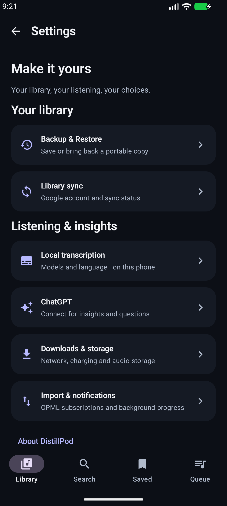
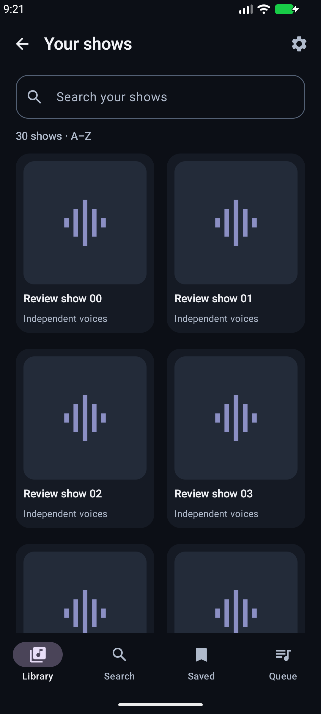
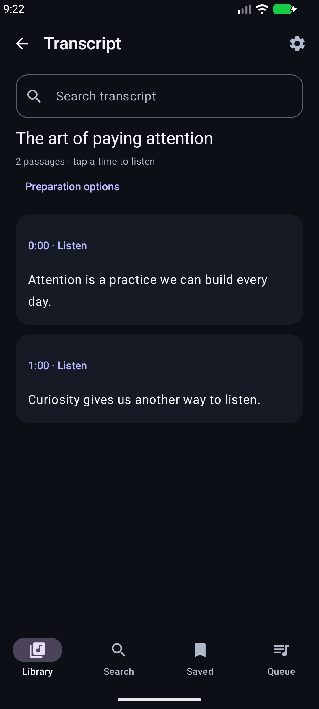

# DistillPod usability and visual review

November 4, 2026. Review of the native app after the Spark sync merge; follows the earlier listening and search proposals. Scope: find, listen, read, save, revisit and manage a personal podcast library. The owner requested autonomous review and improvements.

## Design direction

Keep the recognizable ink, lavender and mint palette and artwork. Give each screen one clear purpose, readable headings and fewer competing actions. Preserve Library, Search, Saved and Queue as the four primary destinations. Use native Compose controls, wrapping text, clear focus/selection states and 48 dp action targets. Content is the visual identity; decorative graphics must not delay reaching it.

## References

- [Pocket Casts Podcasts tab](https://support.pocketcasts.com/knowledge-base/podcasts-tab/): artwork grids and lists make a followed collection browsable. Its illustrated Android layout is a reference, not a claim about the latest release. Apply a searchable gallery to DistillPod's growing library.
- [Pocket Casts queue](https://support.pocketcasts.com/knowledge-base/playing-episodes-and-managing-your-queue/): clear ordered listening and explicit controls. Retain DistillPod's numbered queue and accessible reorder buttons.
- [Snipd](https://www.snipd.com/): its illustrated player gives saving a moment a prominent action and keeps transcript access close to listening. Retain Distill as the player’s primary content action.
- [Apple Podcasts transcripts](https://www.apple.com/newsroom/2024/03/apple-introduces-transcripts-for-apple-podcasts/): readable passages, search and timestamp navigation support finding something heard earlier. Apply local search and clearer passage presentation; do not imply our segment timing is word-level timing.

These are product references, not assets to redistribute or interfaces to copy exactly.

## Screen-by-screen audit

| Area | Finding | Improvement / priority |
| --- | --- | --- |
| Library | The show rail is useful for a few shows but hard to browse with 30 subscriptions. | P1: See all opens an adaptive artwork gallery with local title/author search. Keep resume and latest episodes in Library. |
| Directory search | Artwork, explicit search, preview and RSS entry already exist. | Retain; verify navigation alongside the new local show search so their scopes are clear. |
| Episode details | Listening and preparation compete with lengthy supporting text. | P2: further compact preparation status and expandable show notes after the navigation changes are evaluated. |
| Full player | Controls have a clear hierarchy, but rewind is 15 seconds while the requested lock-screen action is 10. | P1: align full player to −10/+30. Preserve Distill and existing playback controls. |
| Mini-player | Artwork, progress, play/pause and queue are already visible. | Retain; verify it stays operable while searching and navigating. |
| Queue | Explicit order and current/upcoming sections work; no gesture is required. | Retain accessible reorder controls. P2: optional undo for removal; drag only with an accessible equivalent. |
| Saved | Attractive quote cards, but finding a previous idea requires scrolling. | P1: local search across quote, excerpt, insight and episode/show title, with clear empty results. |
| Transcript | Preparation controls take the reader's first screen; no search. | P1: persistent search, readable passage surfaces, highlighted current passage and explicit listen action. Put completed-transcript preparation options behind a disclosure. |
| Insights / chat / explanation | Existing source and generation states are useful; long responses require sustained reading. | P2: consistent reading width and source-link presentation after real long-content review. |
| Settings | Account details, model radio lists, storage and backups form one long page. | P1: grouped overview leading to focused pages; Backup & Restore near the top. |
| Backup and sync | Different concepts can be confused. | Keep separate labels: Library sync for portable listening data; Backup & Restore for manual text transfer. Transcripts stay local under Spark. |
| Errors / offline | Existing status messages preserve local-library usability. | Retain actionable errors. Do not show successful sync as proof of transcript backup. |
| Accessibility | Standard controls generally provide touch semantics; large text and keyboard reduce usable space. | Test search dismissal/clearing, no-result recovery, back navigation and 160% text. Full TalkBack and light theme remain separate acceptance work. |

## Implementation and validation

Implement P1 now without changing storage schema, billing, cloud scope or transcription provider. Keep view-specific search local and bounded, preserve content on empty queries, and retain the user's existing data. Do not automatically issue directory searches, AI requests or transcript generation when a screen is opened.

TDD: add device regressions first for backup discoverability, searching the 30th followed show, transcript filtering/empty recovery and matching saved content. Run them against the previous UI to establish failures, then implement. Re-run existing listening, search and sync-settings regressions, debug lint and build. Inspect real emulator screenshots at normal and enlarged text sizes. Synthetic fixtures run only on the isolated test emulator.

## Deferred scope

Light/system themes need complete contrast testing; sleep timer needs lifecycle behavior; gesture queue editing needs undo and accessibility; Groq needs its own provider/privacy/retry design. These are separate features, not prerequisites for this UI improvement. No new cloud or paid service is introduced.

## Implemented result

Implemented on `feat/ui-design-review`: adaptive searchable show gallery, persistent local search for saved moments and transcripts, focused settings pages, direct account/model shortcuts, −10/+30 player controls, and light system-bar icons matching the app's dark theme. Route state keeps search text when returning from a detail screen. Clearing show search returns the gallery to its first row. Transcripts use selectable text and explicit listen buttons; completed-transcript preparation controls can be expanded when needed.

Validation: the three initial device tests failed against the previous UI for the intended missing controls. After implementation, all ten targeted device tests passed, including the four new review tests, four sync/isolation tests, the real playback/queue/large-text flow, and the directory-search/preview/RSS/large-text flow. A final four-test rerun passed after gallery reset and keyboard polish. Debug and release builds and lint passed. The first playback regression attempt lacked the required public audio fixture; rebuilding with the verified fixture folder resolved that harness error. No owner phone was used for synthetic testing.

Normal and 160% text screenshots were inspected on the isolated emulator. They use synthetic library content; the gallery intentionally demonstrates missing-artwork fallbacks. These checks do not constitute a full TalkBack audit or a physical-phone listening trial. Phone installation and a published release are not part of this review result.

| Settings | Show gallery | Transcript reader |
| --- | --- | --- |
|  |  |  |

Additional previews: [Saved search](evidence/design-review/saved.png), [Settings at 160% text](evidence/design-review/settings-large-text.png).
