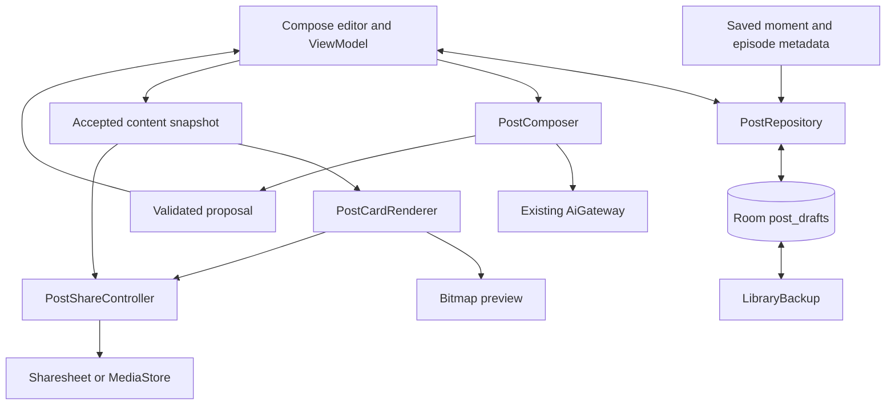

# Design: saved moment to social post

> Superseded after owner testing by the [two-format redesign](social-sharing-redesign.md). This document records the first implementation and its technical validation, not the accepted product direction.

Status: V1 implemented on `feat/social-sharing`; automated and emulator validation recorded below. Updated November 5, 2026. Working feature name: **Create post**. Product name: **DistillPod**.

## Outcome and scope

A listener can turn a saved podcast moment into an editable social post, add a personal perspective, preview a card, and share text or an image. The reader receives a useful idea and source attribution without needing DistillPod installed.

V1 includes LinkedIn text, Instagram captions and cards, local draft persistence, backup/restore, explicit AI writing assistance, two layouts, three themes, PNG saving and native Android sharing. Post content supports English and Brazilian Portuguese. The existing capture and quick Share action remain available.

Carousels/story layouts follow in V1.1. Optional AI illustrations require verified support for the current ChatGPT connection and asset backup in V2. Public pages are conditional on demand and require a separate hosting/publication design. Social login, automatic publishing, scheduling, video clips and a product rename are outside V1.

## Decisions

| Decision | Reason |
| --- | --- |
| Posts are separate from saved moments | Editing publication text must preserve original source material |
| A draft owns a source snapshot | Deleting a capture must not delete authored work |
| Local editing and export work without AI | Account availability must not block existing content |
| AI returns a proposal for review | Users retain control and typing cannot be overwritten by a late result |
| Typography is rendered locally | Preview and export match; text stays readable and editable |
| Source fields are assembled by the app | Models cannot invent URLs, timestamps or speaker attribution |
| Native Sharesheet handles distribution | Users finish publication in the destination app |
| Drafts have backup support but no cloud sync | Existing moment sync does not imply a new draft conflict protocol |

## User experience

Open a saved moment and select **Create post**. The editor initially uses its quote and insight. No generation request is made merely by opening it. Choose LinkedIn or Instagram, optionally add “Your perspective,” then edit headline, takeaway, body/caption and quote. Quotes stay in their original language; translated interpretation belongs in the takeaway with a translation label.

**Draft with AI**, **Shorten**, **Simplify**, **Rewrite opening**, and **Use my perspective** explicitly request text generation. The result appears under Suggested revision with Use version and Keep current. An accepted proposal can be undone once. Editing while generation runs cancels the request and invalidates the result.

Design & preview offers Idea or Quote, Ink/Lavender/Mint themes, portrait or square size, optional DistillPod branding and an image-description field. Preview uses the actual rendered bitmap. A missing quote, blank takeaway or overflowing text produces actionable feedback instead of clipped output.

Share text, Copy caption, Share image and Save image remain explicit actions. Copy image description supports manually supplying alt text in the destination app. A chooser return is never labeled as a successful publication. Captions may need pasting manually depending on recipient behavior.

Drafts are accessible from their original moment and the Post drafts action in Saved, including when no captures remain. Users can duplicate or delete drafts. Removing a source moment detaches its drafts and retains source snapshots. No new top-level navigation destination is introduced.

## Content contract

LinkedIn writing targets 80–180 words with a concrete opening and short paragraphs. Instagram captions target 40–120 words. These are editorial preferences rather than platform limits. Quotes, source labels and URLs are appended separately by the app.

| Element | Behavior |
| --- | --- |
| Headline | One concrete idea; no default clickbait |
| Takeaway | Explanation grounded in the saved excerpt |
| Perspective | Optional user input; AI may polish but cannot invent experiences or beliefs |
| Quote | Contiguous source wording with whitespace normalization |
| Attribution | Show, episode and original time window; no guessed speaker identity |
| Link | Public publisher page or user-supplied public URL |
| Branding | Small and removable; attribution remains |

The app retains episode and show webpage links parsed from RSS and Atom. Automatically populating a draft link additionally requires an existing public-feed approval. Unknown sources omit the link. V1 uses a conservative URL policy: HTTP(S), named host, no credentials or query parameters. Users can supply a public link manually. Signed media URLs, transcript URLs, feed URLs and GUIDs are not substitutes for a publisher page. No universal playback-time URL parameter is invented.

## Architecture

`PostRepository` creates source snapshots and performs transactional revision-checked saves, duplication and deletion. The existing Room schema 8 already contains the draft entity and SET NULL source relationship, so V1 needs no additional schema migration.

`PostContent` contains versioned JSON for immutable source fields, editable content and visual settings. It validates bounds, formats, quote membership and URL policy. `core/SocialPost.kt` holds platform-independent source policy and timestamps.

`PostEditorViewModel` owns editor state, serializes saves with a mutex and debounces autosave. SavedStateHandle retains edits for process recreation; durable drafts are in Room. Saves use the persisted revision to reject obsolete writes. A sequence counter invalidates asynchronous generation after edits/cancellation. Results remain proposals until accepted. Requests do not automatically restart after process death.

`PostComposer` sends a bounded excerpt, current content, destination, language, action and optional perspective through the existing text gateway. It requests JSON, validates required fields and content limits, and leaves all source fields unchanged. Transcript and user content are treated as data rather than instructions. No new provider authentication or billing path is introduced.

`PostCardRenderer` uses Canvas/StaticLayout at 1080 × 1350 or 1080 × 1080. It measures all blocks and rejects overflow before allocating the bitmap. Headline, primary idea/quote, source footer and optional branding have fixed readable sizes. Image generation does not render typography. V1 uses typography-only cards; publisher artwork is an optional future visual enhancement.

`PostShareController` formats text, exports unique PNG files off the main thread, grants content-URI access through a narrowly scoped FileProvider, and saves requested images through MediaStore. Shared files remain available for seven days and are cleaned on subsequent exports. Failed MediaStore writes are removed. No storage permission is needed on the app's supported Android versions.

## Persistence and compatibility

`PostDraftEntity` stores UUID, nullable source moment ID, content JSON, revision and updated time. The foreign key detaches drafts when their source is deleted. A duplicate receives a new UUID and retains the same snapshot. Deleting a draft does not delete its moment.

Source snapshot fields include show/episode titles, excerpt, time window and fingerprint. Saves cannot modify those fields. A validated source URL is separately editable. Editing original capture data does not silently refresh published wording. A changed audio fingerprint produces a replay warning.

Library backups include drafts and source snapshots, exclude temporary export PNGs and preserve the established keep-existing conflict policy. Older backups normalize absent draft/URL fields before strict validation. Draft content is validated on restore. Drafts remain local unless the user transfers a backup; they are not added to the existing saved-moment sync protocol.

## Failure handling

| Failure | Behavior |
| --- | --- |
| No transcript | Manual Idea card remains available; AI requires source text |
| Invalid quote | Save/export reports the mismatch; move paraphrased wording to takeaway |
| Invalid AI JSON or oversized result | Preserve accepted content and report failure |
| Authentication, quota or network failure | Preserve the local draft; retry explicitly |
| Edit during generation | Cancel/invalidate the request and preserve typing |
| Source deleted | Draft stays accessible in Saved with its snapshot |
| Source audio changed | Warn before relying on replay time |
| Save failure | Show unsaved state, retain editor content and offer retry |
| Card overflow | Identify fit problem; shorten content or use portrait |
| Export/storage failure | Retain draft and report failure; text copy remains available |
| Recipient drops caption | Copy caption and paste manually |

## Privacy and publication boundaries

Opening, editing, rendering and saving do not invoke AI. Explicit composition sends selected transcript text, draft text and perspective through the connected ChatGPT account. Text/image sharing sends the chosen output to another app. No remote telemetry or public hosting is added. AI image support remains unverified for this connection and is not advertised in V1.

## Alternatives and later gates

A screenshot of the capture screen would tie output to device dimensions and app controls. A separate renderer gives intentional publication layouts. Editing the capture itself would destroy the original learning record, so drafts are independent. Generating whole cards as images would weaken typography, quote accuracy and editing, so AI artwork will be a supporting layer only.

Direct publishing APIs and public pages introduce account permissions, hosting and publication ownership. They remain separate work. Public pages would require explicit publish/update/unpublish, social metadata, retention and abuse handling. Draft sync needs explicit conflict rules and asset transfer. A rename depends on evidence that social creation has become the main use case.

## Validation and rollout

Focused tests cover feed parser parity, safe links, quote matching, immutable snapshots, revision conflicts, source deletion, backup round trips, composition validation, render dimensions/overflow, MediaStore and FileProvider restrictions. Run the complete JVM suites, debug lint, app assembly and Android-test compilation.

Device acceptance should cover creating/editing/reopening drafts, previewing both layouts, TalkBack, enlarged text, process recreation and real LinkedIn/Instagram composer handoffs. Do not publish test content. Record recipient app versions; a handoff is not confirmed publication.

Start with a personal alpha, then a two-week pilot with 5–10 listeners. Look for completed posts, repeat use, time to export, editing burden and handoff friction. Collect pilot feedback without adding remote analytics. Add carousels, illustrations or public pages based on repeated needs.

See [validation evidence](evidence/social-sharing-validation.json) for checks actually executed and remaining device limitations.

V1 validation passed 85 core and 176 app JVM tests, debug lint, debug app/test assembly, and one API 36 emulator acceptance flow at 160% text. The [preview screenshot](evidence/social-sharing-preview.png) shows fixture content only. Live ChatGPT requests, recipient-specific LinkedIn/Instagram handoffs, TalkBack and physical-device acceptance remain unverified.
