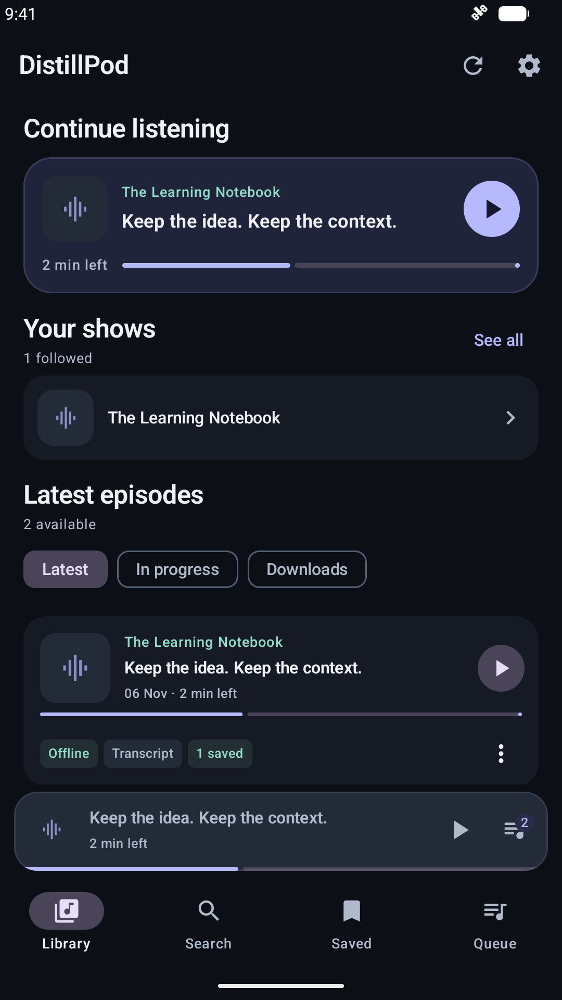
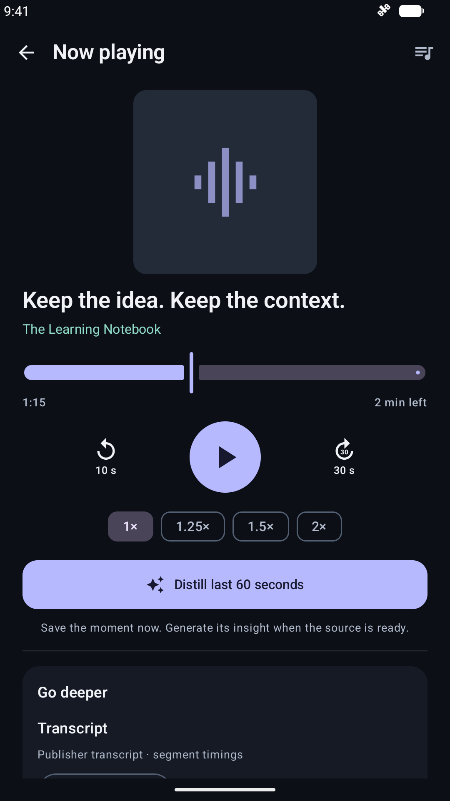
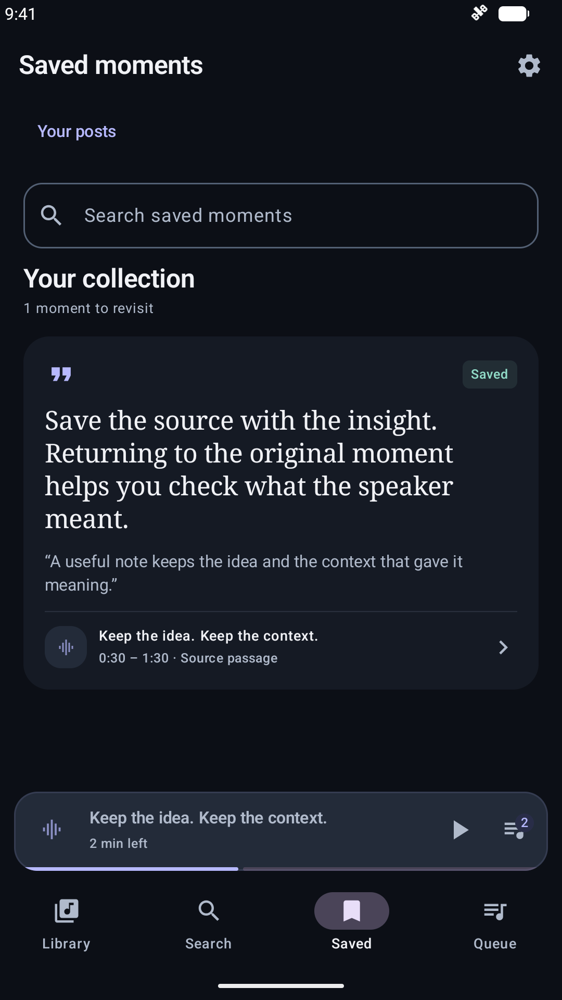
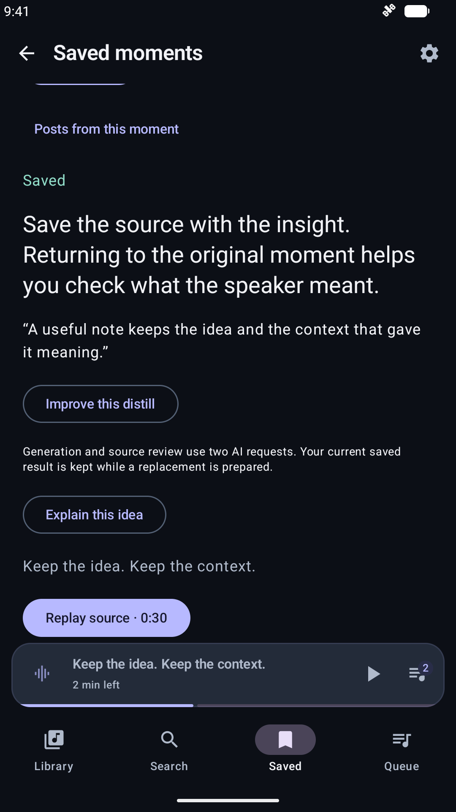
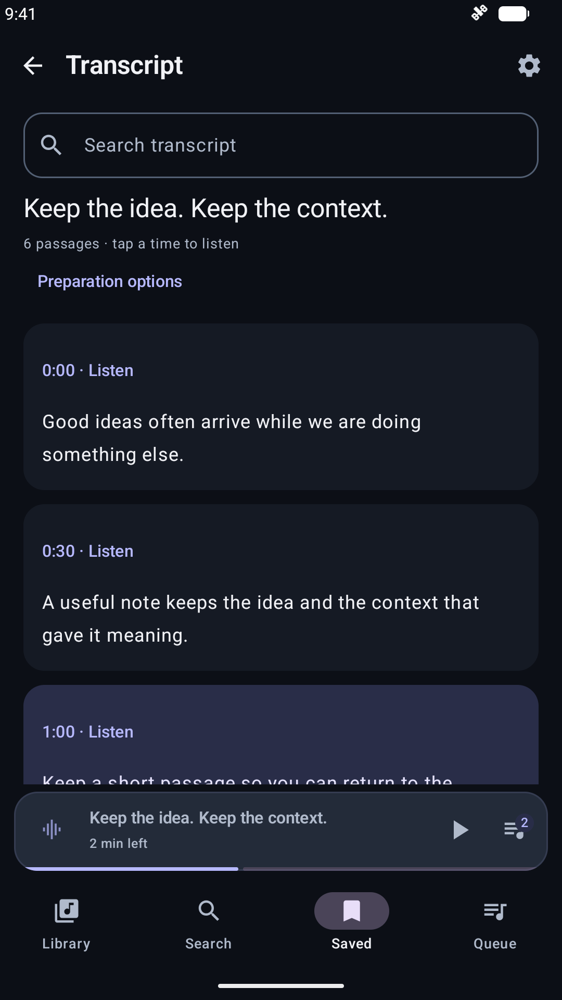
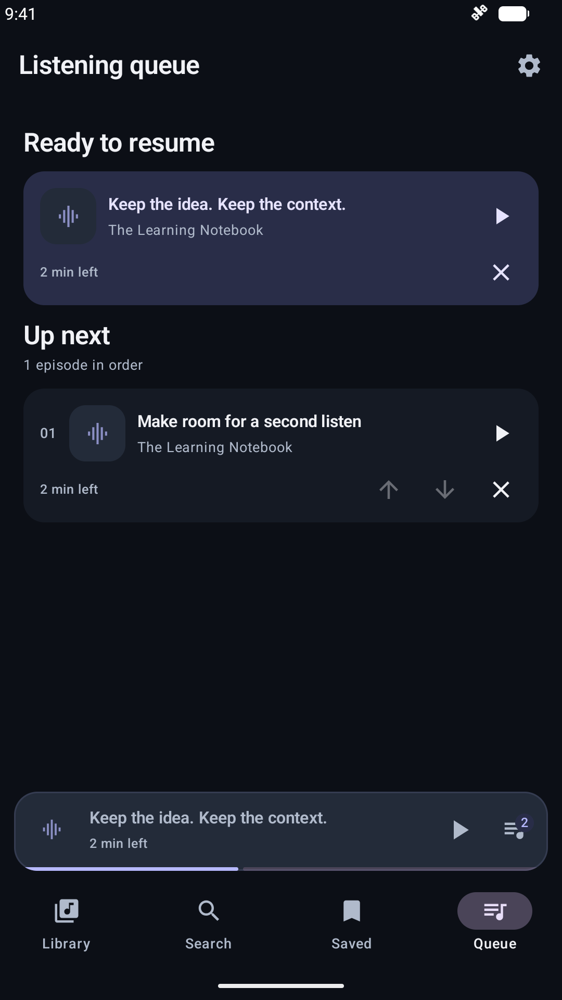
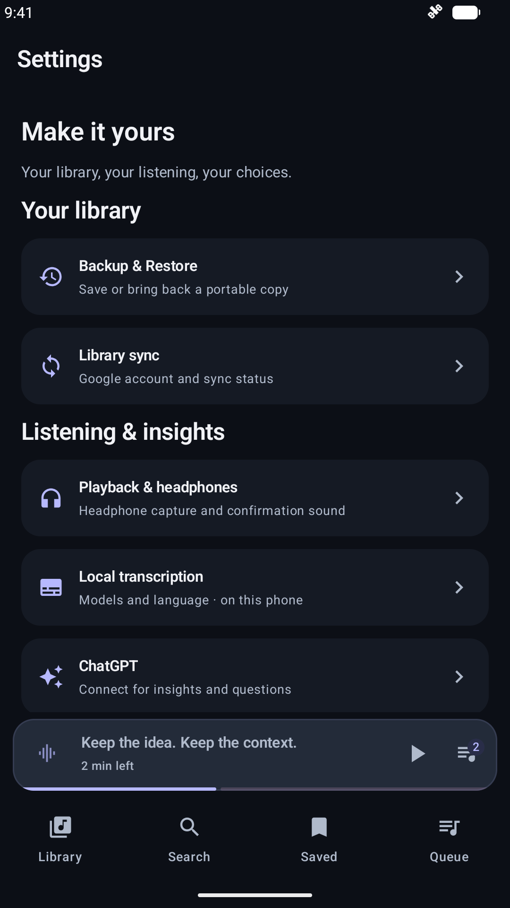
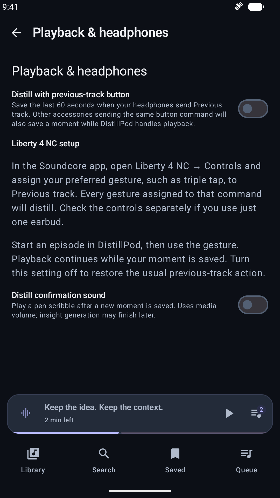

# Watch DistillPod

These short, silent videos have captions and show the actual Android interface.
The fictional show **The Learning Notebook**, transcript and example takeaway
were created for documentation. No personal library, account or live AI request
was used. Screens and recordings follow source `bad8488` / 0.15.0-alpha.1.

## Hands-free headphone capture

[Watch the headphone-capture video](headphone-capture.mp4).

1. Open **Settings → Playback & headphones** and turn on **Distill with previous-track button**.
2. Start listening. Map the desired earbud gesture to **Previous track** in the accessory's app, where supported.
3. When that media-button command arrives, DistillPod saves the preceding minute and keeps playback running.
4. Open Saved to revisit the moment. The example result shows a takeaway and quote; **Replay** returns to the original passage.

The video sends Android's previous-track media key from the emulator. It does
not show a physical earbud gesture, the Soundcore app or Bluetooth sound routing.
The shown takeaway is supplied example output, not evidence of live AI quality
or generation speed. See [headphone setup and limits](../android/headphone-distill.md).

## On-screen distillation

[Watch the distillation video](distillation.mp4).

1. Listen in the full player and tap **Distill last 60 seconds**.
2. The source moment is saved immediately. When ChatGPT is disconnected, it stays available while waiting for the connection.
3. The walkthrough then supplies an example finished takeaway and quote to show the result screen.
4. Tap **Replay** and return to the original audio position.

Real generation needs an eligible connected ChatGPT account and a suitable
source transcript. It includes source review, can take longer, can fail, and
may produce a takeaway without a quote. The recording does not make an account
request or simulate provider progress. [How contextual distills work](../android/contextual-distills.md).

## Screenshots

Select an image for its full-size view. These are unretouched emulator captures
with Android's demonstration clock and battery display; content is synthetic.

| Library | Player |
| --- | --- |
|  |  |

| Saved moments | Finished example |
| --- | --- |
|  |  |

| Transcript | Queue |
| --- | --- |
|  |  |

| Settings | Headphone setup |
| --- | --- |
|  |  |

## Reproduce the captures

Use a new, empty Android emulator with no accounts. Do not install the fixture
or run these commands on a personal phone or an emulator holding personal data.
The capture class requires an explicit opt-in, refuses physical hardware and
checks for an empty, disconnected app. Ordinary CI skips it.

With the [development tools](../development.md) configured, build and install
both APKs on that emulator. Substitute its serial for `emulator-5556`:

```sh
./gradlew :app:assembleDebug :app:assembleDebugAndroidTest
adb -s emulator-5556 install -r app/build/outputs/apk/debug/app-debug.apk
adb -s emulator-5556 install -r app/build/outputs/apk/androidTest/debug/app-debug-androidTest.apk
python3 scripts/capture-docs-media.py --serial emulator-5556 --mode screens --output /tmp/distillpod-docs-capture
python3 scripts/capture-docs-media.py --serial emulator-5556 --mode headphones --output /tmp/distillpod-docs-capture
python3 scripts/capture-docs-media.py --serial emulator-5556 --mode distill --output /tmp/distillpod-docs-capture
```

The script accepts `--adb` and `--port` for a Windows-hosted emulator. In WSL,
pass Windows APK paths to Windows ADB when installing. It records real capture,
continued playback and replay, writes local instrumentation receipts, and removes
its fictional library rows afterward. Audio is generated silence. It neither
downloads a model nor authenticates an account. Rebuild after changing the
fixture; reused production APKs are not suitable for this flow.

To add the caption band with FFmpeg (including the libass/subtitles filter):

```sh
python3 scripts/render-docs-videos.py --input /tmp/distillpod-docs-capture --output /tmp/distillpod-docs-rendered
```

Review caption timings after any fixture or UI change. The [rendering script](../../scripts/render-docs-videos.py) preserves the app frames and emits portable H.264/YUV420p MP4s with fast-start metadata.

Raw videos are H.264 screen recordings. The published copies add a separate
caption band and remove recording setup/tail time; app frames are not replaced
or retouched. They remain silent. Keep source captures outside Git, inspect
all frames/screens for personal content, then record each approved final file's
path and SHA-256 in [reviewed-assets.json](../../security/reviewed-assets.json).
Media review is required even when the fixture assertions pass.

The [capture fixture](../../app/src/androidTest/java/dev/distillpod/android/DocumentationMediaDeviceTest.kt)
and [host script](../../scripts/capture-docs-media.py) are part of the repository.
These demonstrations are documentation evidence, not physical-headset or
live-model acceptance tests.
