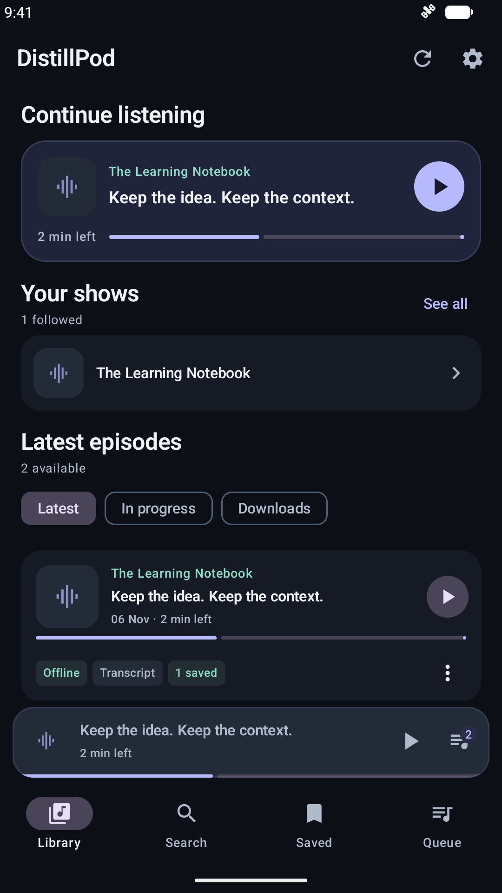
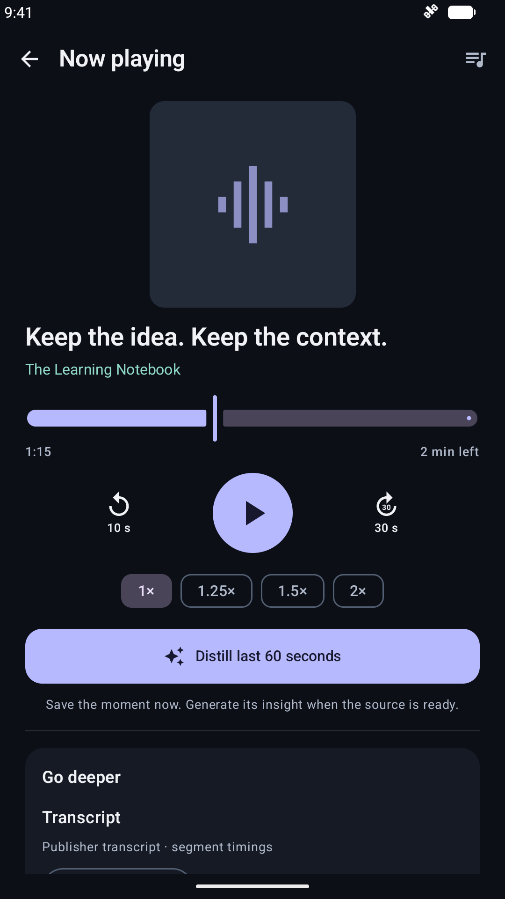
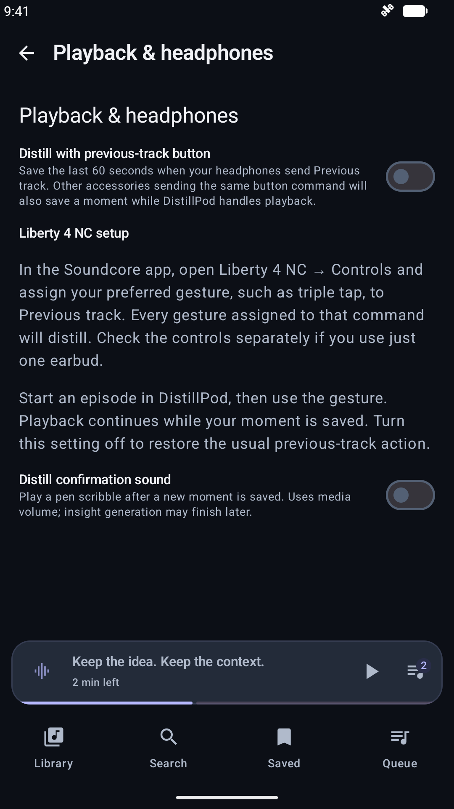
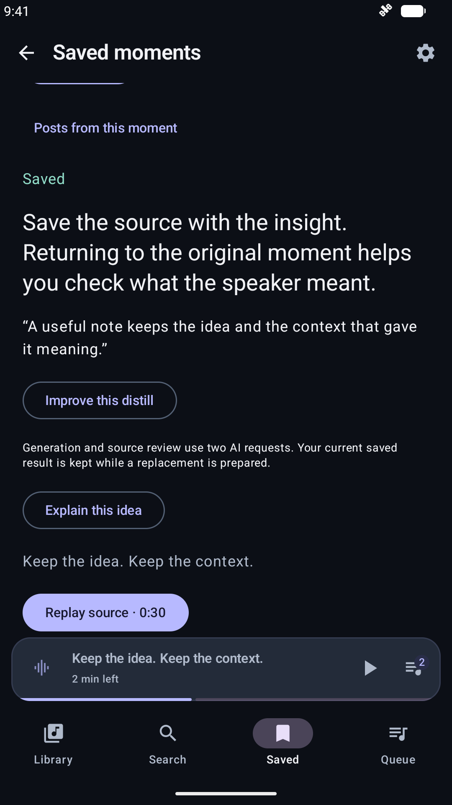

# Getting started

Install the APK attached to a [GitHub release](https://github.com/andrepaim/distillpod/releases). Android 10 or later is required. A newer compatible release installs over the current app; keep the application installed to retain its private data.

This guide follows `main`, which can be ahead of the downloadable APK. Check the release notes and [implementation status](android/implementation-status.md) for feature availability in your build.

Watch the [headphone-capture demo](demos/headphone-capture.mp4) or the
[on-screen distillation demo](demos/distillation.mp4). Both use synthetic content;
[transcripts and recording details](demos/README.md) describe the examples.
For a first session: follow a show, play an episode, prepare its transcript, then
save a moment. ChatGPT adds the generated takeaway; saving the source works even
when disconnected.

## Connect ChatGPT

Start in **Settings → ChatGPT → Continue with ChatGPT**. The connection powers DistillPod's quotes and insights, episode summaries and chapters, episode chat, saved-idea explanations and interest-based podcast suggestions. Account/model eligibility and plan limits apply; requests use your ChatGPT plan allowance.

Complete browser sign-in and return to DistillPod for its final connection result. A provider email alone does not establish that the app finished connecting. A retry can use more allowance. Playback, local transcription and source-moment capture also work without the connection.

## Follow your shows

Open Search and enter a show name or creator. Preview the artwork and publisher, then Follow. Search uses Apple’s iTunes podcast directory, so a show might require its public RSS address instead. Add RSS feed accepts that address directly. Settings also imports OPML subscription lists.

A subscription fetches feed metadata and episode listings. Download audio explicitly from an episode when you want offline playback. Search history is local and can be cleared.

## Listen

The library offers Continue listening, followed shows and recent episodes. The show gallery lists followed shows alphabetically and offers local search. Saved and transcript screens also offer text search. Use Play next or Add to queue to choose what comes next. The mini-player opens the full player and queue. The player rewinds 10 seconds and advances 30 seconds; speed choices are 1×, 1.25×, 1.5× and 2×. Playback can continue with the screen locked; Android media controls offer transport actions.

Downloaded episodes can play without a network connection. Streaming requires access to the publisher's audio host. Listen from the original source timeline; reviewed ad ranges are optional, and seeking into a range lets you hear it normally.

| Library | Full player |
| --- | --- |
|  |  |

## Prepare a transcript

Transcript preparation starts automatically when you play an episode, including playback from system controls and automatic queue advancement. **Settings → Transcript preparation → Transcribe when playing** defaults to on, including after an upgrade. Turn it off to stop new automatic requests; existing jobs continue until you use **Pause transcript**. Turning it on during playback prepares the current episode. The setting stays on this device.

Publisher transcripts are used when suitable. Optionally enable **Settings → Transcript preparation → Look for existing online transcripts** to search PodcastTranscript.ai for an existing transcript of a public show before Whisper. Lookup sends the episode title, requires a directory follow or explicit public-source approval, and never uploads audio or starts cloud transcription. If lookup is disabled, unavailable or finds no suitable match, choose Tiny or Base in Settings and download the model. Model downloads remain explicit; preparation waits for the model and resumes after its download. You can also prepare a transcript manually from the episode's tools. Local processing shows its current phase and progress, and completed chunks remain available after pause/resume. Longer recordings take time and use battery; model and language choices affect performance.

Playback reuses completed transcripts and existing jobs. Explicitly paused, failed and partial transcripts retain their manual resume controls. Changing the selected model or language does not regenerate existing text when you press Play; use **Transcribe locally again** for that. Updated audio can start a new transcript revision. Stopping playback does not stop transcription.

Automatic language detection, English and Português are available. A partial transcript is identified as partial rather than treated as complete. Online transcripts support reading and episode understanding; saved moments and automatic ad skipping still require publisher or local timing. **Transcribe locally again** bypasses online lookup. See [lookup design and limitations](android/online-transcripts.md).

Audio and model downloads default to Wi-Fi/unmetered networks. In **Settings → Downloads & storage**, adjust the download policy if needed. If **Settings → Transcript preparation → Only transcribe while charging** is enabled, connect power to let new transcription chunks run.

## Understand an episode

Once the complete transcript is ready, open **Summary & chapters** to generate an overview and jump to chapter timestamps, or open episode chat to ask questions about what was said. Answers use transcript excerpts and source references; replay the relevant audio to check the context.

## Ask while listening

The 0.16.0 personal-alpha distribution includes the voice preview. Save an OpenAI project API key in **Settings → Voice**, prepare a publisher/local transcript covering the current position, and use **Ask about this** in the player. Grant microphone access, wait for the tone, then ask. The sheet shows a live input waveform and a bounded answer transcript. Normal completion returns to the same podcast when playback has not changed. **View last answer** reopens the latest response without a new request. Voice uses your API key's allowance, separately from the connected ChatGPT account.

For headphones, enable **Next track → Ask about the podcast** under **Playback & headphones**, grant microphone/notification access, and start playback with the app open. Wait for **Headphone voice ready** before locking the phone. Expand **Headphone setup** for gesture and route requirements. Supported Android Auto hosts use the usual DistillPod launcher entry; reconnect after updating and look for native **Ask**. See [voice setup and limitations](android/voice-mode.md) and [headphone voice](android/headphone-voice.md).

## Keep a moment

While listening, select Distill last 60 seconds. DistillPod records that original source window immediately. Open Saved to revisit the excerpt and replay it. Source preparation or AI failure retains the capture for review and retry.

With ChatGPT connected and the source transcript ready, DistillPod can generate a quote and concise insight for the saved moment. Source review may be required before generation. Choose **Explain this idea** to explore the excerpt further through an explanation, practical reflection and questions to investigate. Explanations use the transcript; they do not search the web.

To capture from headphones, enable **Settings → Playback & headphones → Previous track → Save moment** (off by default). In the Soundcore app, assign your Liberty 4 NC gesture, such as triple tap, to **Previous track**, if available. While DistillPod handles playback, that button command saves the preceding minute without skipping. Other gestures or accessories sending the same button command will also distill. Turning the option off restores the usual previous-track action; single-earbud controls may need separate setup.

A pen-scribble sound confirms a new saved moment, independently of later insight generation. Adjust **Moment saved sound** on the same settings page; it uses media volume. See [headphone setup, design and validation limits](android/headphone-distill.md). Actual Liberty 4 NC gesture and Bluetooth routing still require physical-device validation.

The completed takeaway may have no quote when the source does not support a
standalone quotation. **Improve this distill** keeps the current result while
preparing a replacement; **Previous versions** can restore an earlier result.
If more context is needed, use the offered context/transcription retry instead
of repeatedly capturing the same instant. See [contextual distills](android/contextual-distills.md).

| Headphone setup | Example finished moment |
| --- | --- |
|  |  |

## Sync supported library data

In a configured build, open **Settings → Library sync → Connect Google & sync library**. Review existing feeds, approve only public sources, then choose the Google account for this library. Google sign-in is separate from ChatGPT and from the Drive file picker. An unconfigured source/debug build shows “Cloud sync is unavailable in this build.”

Approved subscriptions, listening progress, played status and saved moments synchronize. **Sync queue & preferences** additionally shares queue order and transcription model/language/AI-model choices. Full transcripts, analyses, episode chat and explanations still require Backup & Restore for transfer. Downloads, models and credentials stay on each device.

Update every installation before enabling contextual-moment sync's account
protocol upgrade. Until then, new-format moments can remain pending while other
supported changes sync. [Protocol compatibility](android/subscription-sync.md#contextual-moments-and-protocol-3)
explains the explicit upgrade and older-client behavior.

Use the same Google account on another installation. Offline changes wait for reconnection; conflicts offer **Keep this phone’s choice** or **Use the cloud choice**. Pause or sign out to stop sync while keeping the local library. The library remains bound to its original account; account switching and complete account erasure are not implemented. Sync propagates changes and deletions, so keep independent backups. See the [sync guide](android/subscription-sync.md).

## Back up or move devices

Settings → Backup & Restore → Create backup file connects a Drive document once, with a suggested filename. After setup, Back up now saves without another picker, and Restore a backup shows dated snapshots in the app. Reconnect that file once after reinstalling or on another phone. Import older backup supports standalone JSON files and shows all file types. Restore previews and safely merges data, keeping existing local records. See the [Drive backup guide](android/drive-backup.md) for retention, privacy and recovery.

Credentials, downloaded audio, model binaries and private device file paths are excluded. Reconnect the account and re-download audio/models on a destination installation. OPML transfers subscriptions only.

To report a listening problem, enable **Settings → Diagnostics → Share diagnostics** before reproducing it. Afterward, use **Copy diagnostic reference** and include the approximate time, action tried, expected result and what happened. Reports upload when connected, including mobile data; **Send test diagnostic** verifies the path with a harmless handled error. See [cloud diagnostics](android/cloud-diagnostics.md) for privacy and delivery limits.

Developer checks are diagnostics for deliberate testing. They are not needed for normal listening, and fixture suites belong on an isolated emulator.

## Create a social post

Open a prepared saved moment and tap **Create post**. Choose **Quote & discussion** for a well-spaced text post built around an exact quote, or **Infographic** for an illustrated explanation enriched with web research. The app chooses language, structure and visual treatment automatically and begins generation immediately through the connected ChatGPT account.

The completed result offers **Share** and an optional **Change** instruction. The menu includes copying, direct discussion editing, undo, image saving and deletion as applicable. You can leave the screen during generation; failed or canceled changes preserve the last completed version. Finish publication in the receiving app, and copy the infographic description separately if the recipient does not retain it.

Find results through **Saved → Your posts**, even after deleting the original moment. Posts and infographic assets are local and included in bounded library backups; library sync does not upload them. Infographics use AI-designed vector scenes rendered locally because the current account connection does not support the hosted image-generation tool. Reopening or sharing a completed result does not regenerate it.

## When something needs attention

Use [Troubleshooting](troubleshooting.md) for transcript waiting states, a saved
moment without a takeaway, headphone controls, sync conflicts, backups and APK
updates. The [documentation index](README.md) links the complete current guides
and distinguishes them from historical validation reports.
